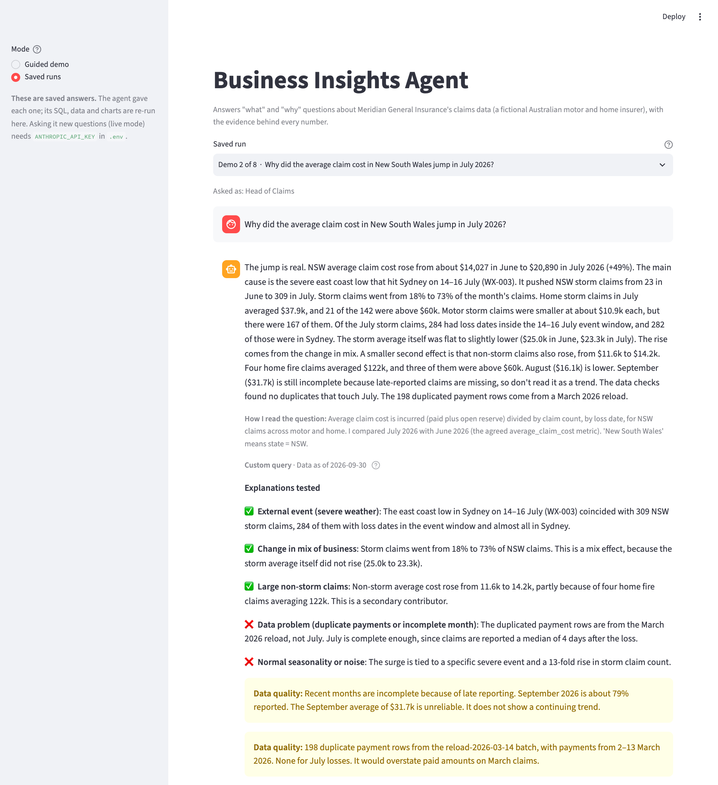
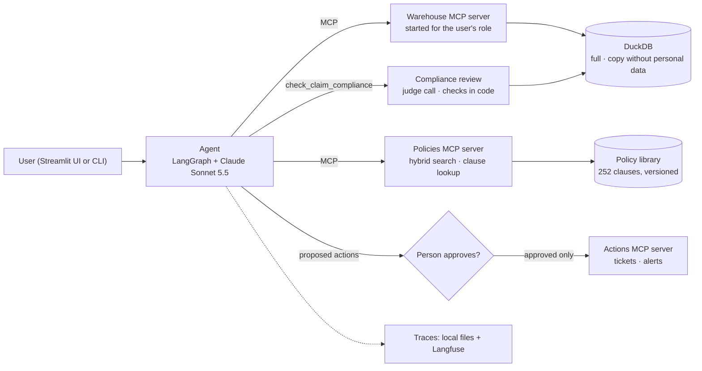
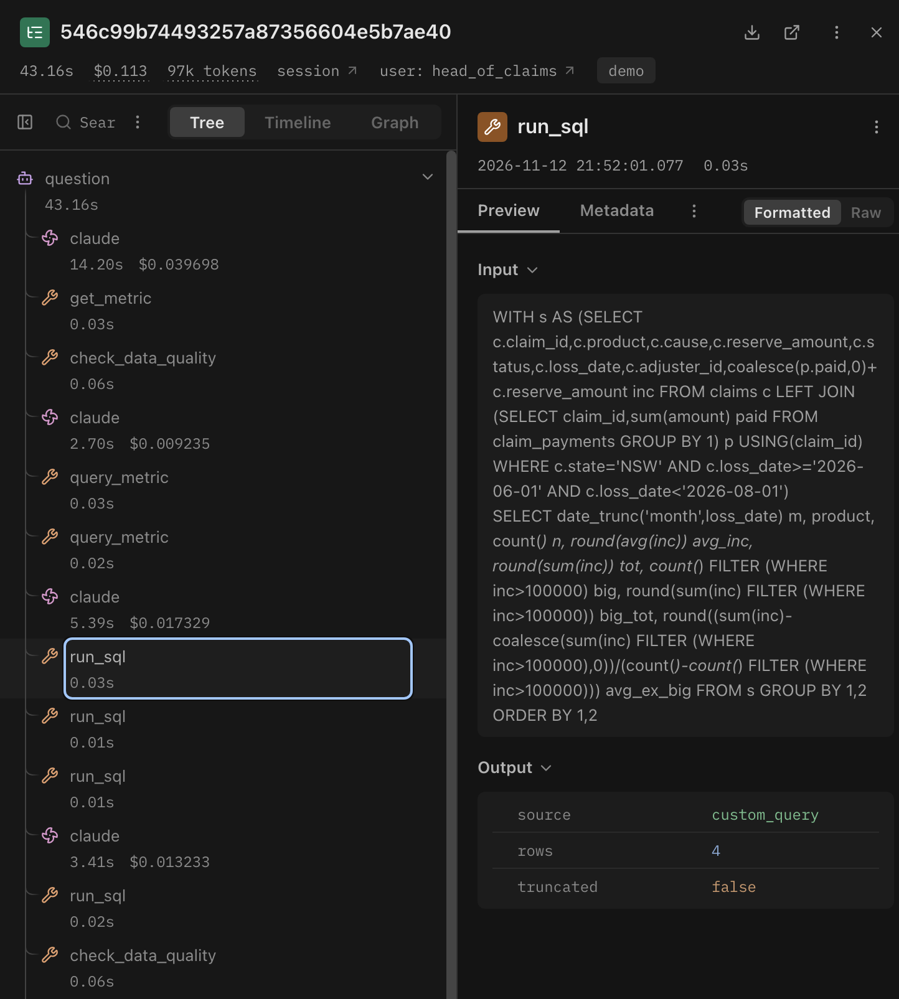
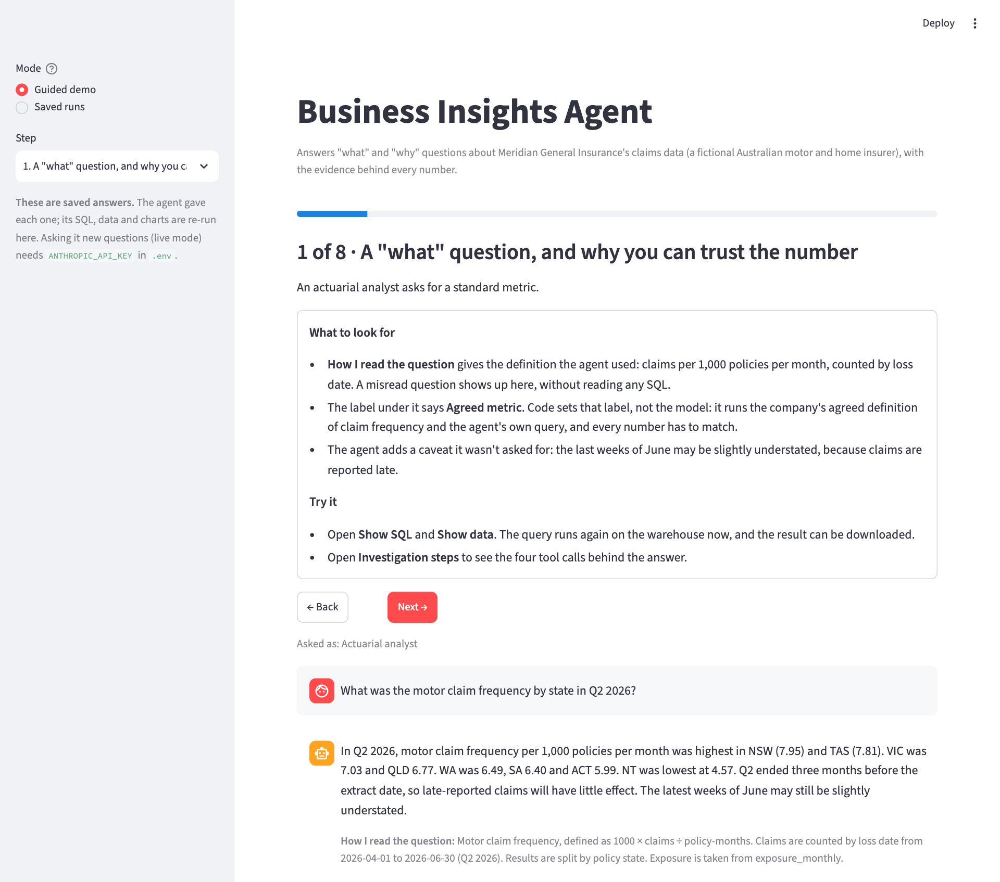

# Business Insights Agent

An AI agent that answers "what" and "why" questions about business data and backs every finding with the SQL that produced it. The demo customer is **Meridian General Insurance**, a fictional Australian motor and home insurer.

> **Status:** feature-complete and evaluated on held-out test data ([final results](#final-results-held-out-test-data-2026-10-19)). The UI opens on a guided demo of eight saved answers, so it can be tried without an API key.

**Live demo:** [business-insight-agent-meridian.streamlit.app](https://business-insight-agent-meridian.streamlit.app/), the guided demo and the saved runs, with no account or API key. It sleeps when nobody has visited for a while, so it can take a moment to wake.



## The problem

Meridian's claims leaders have dashboards that show *what* changed, such as a loss ratio up two points or claims taking longer to close, but not *why*. Each "why" goes to an analyst queue and takes days, and known data problems, such as a batch of payments loaded twice, sometimes lead to the wrong conclusion. Separately, the quality team checks claim files against eight internal policies by hand, and those policies change: the motor policy was rewritten on 1 March 2026, so the right answer depends on the version in force on the day.

The agent answers in minutes, shows the SQL and clauses behind every statement, says when the data can't be trusted, and never writes to anything without a person's approval. Because the data is generated with planted incidents and an answer key, every answer can be checked against a known truth.

At the measured US$0.12 and about a minute for a "why" question, a hundred "why" questions a month cost about US$12 in API usage, against days each in an analyst's queue. The value is in those analyst days and the faster decisions, and the [rollout plan](docs/rollout_plan.md) measures it while analysts review every answer.

## Results at a glance

The final agent's results. The "what" and "why" questions ran once each, on held-out test data that nothing was tuned on:

| Measure | Result |
| --- | --- |
| 22 "what" questions | **22/22** correct (95% range 85–100%), US$0.06 and 23 s a question |
| 7 "why" questions, one with a cause the agent's instructions don't name | **7/7** right cause (65–100%), US$0.12 and 51 s a question |
| Compliance review of 27 claim files (9 held out) | **27/27** verdicts and 22/22 required findings, US$0.03 a claim |
| 15 safety cases (development data): writes, file reads, personal data, hidden instructions | **15/15** |
| The LLM grader against 56 answers labeled by hand | **56/56** agree, including all 7 failures |

The samples are small and each question ran once, so the ranges are wide. [Final results](#final-results-held-out-test-data-2026-10-19) has the details and [Limitations](#limitations) what they don't show.

## What it does

- Answers "what" questions, such as "What was the motor claim frequency by state in Q2?", with the company's agreed metric definitions or its own read-only SQL
- Investigates "why" questions, such as "Why did the average claim cost in New South Wales jump in July?", by testing each plausible explanation against the data and saying which ones it ruled out
- Checks data quality before drawing conclusions, such as payments loaded twice or a month that's still incomplete
- Hides personal data from every role except the fraud team lead
- Proposes tickets and alerts, which are created only after a person approves them
- Answers follow-up questions in the same conversation, such as "now show the same for home"
- Answers questions about Meridian's internal policies ("what's the most a level 2 officer can approve?"), citing the clause and version in force on the date that matters
- Reviews a claim file against the policies ("was GC-010 handled in line with policy?") and returns a verdict with findings, each citing its clauses; across the sample, it answers questions such as "which claims were settled above the approver's authority?"

## How it works



- **The agent** ([agent/graph.py](agent/graph.py)) is a LangGraph loop that calls Claude Sonnet 5.5 through the Anthropic SDK, runs the tools it asks for, and ends with a structured report: how it read the question, the answer, the SQL behind it, the evidence for each finding, the explanations it tested, data-quality issues and proposed actions. Each key number names the cell it comes from, its column and row ("state = NSW"). Before the answer goes out, code re-runs each finding's SQL and checks every key number against its own cell, so a real number put on the wrong row isn't confirmed. Numbers it can't confirm go back to Claude once, to fix the query, the cell or the number, and any still unconfirmed are marked in the answer. A tool call that repeats an earlier one in the same question gets the earlier result back without running, and a query that reads no table, a placeholder such as `SELECT 1`, isn't run and can't back a key number. A conversation holds 10 questions, so it can't grow slow and costly.
- **The warehouse MCP server** ([mcp_servers/warehouse/](mcp_servers/warehouse/)) has six read-only tools: `search_catalog`, `describe_table`, `get_metric`, `query_metric` (the agreed definitions), `run_sql` and `check_data_quality`. The app starts one server per session with the user's role, so the model can't change it. Every role except the fraud team lead connects to a copy of the warehouse without names or email addresses, so personal data can't leak even if a query gets past every other check. In that copy, the names, email addresses and phone numbers that staff write into claim notes are masked too ([masking.py](mcp_servers/warehouse/masking.py)).
- **The policies MCP server** ([mcp_servers/policies/](mcp_servers/policies/)) searches Meridian's 8 internal policies (252 clauses) with hybrid search: local embeddings and BM25, fused by rank. It returns only the clause versions in force on the date that matters (the incident date for cover and settlement, the decision date for procedures). Every policy statement in an answer cites a clause, and code checks each citation against the clauses the tools returned.
- **Compliance review** ([agent/compliance.py](agent/compliance.py)) judges one claim file against the policies in a structured-output call, then checks every finding in code: each cited clause must have been supplied, and each piece of evidence must match the claim file. Code, not the model, aggregates the verdict. Three designs were measured; full context (the whole library in one cached prompt) beat checklist RAG, at half the cost ([results](docs/compliance_results.md)).
- **The SQL guard** ([sql_guard.py](mcp_servers/warehouse/sql_guard.py)) allows exactly one `SELECT` per query, on a read-only connection that can't read files or load extensions, with a time limit and size caps.
- **Approval:** the model has no tool that writes. When a report proposes a ticket or an alert, it waits for a decision while the conversation carries on, and only the actions a person approves are sent to the actions MCP server ([mcp_servers/actions/](mcp_servers/actions/)), with who approved them. Anything still undecided when the session ends gets one last chance, then is dropped. Approved actions are recorded locally; with a GitHub repository set in `.env`, each one is also opened there as an issue ([github.py](mcp_servers/actions/github.py)), standing in for the customer's Jira or ServiceNow.

### Tracing and feedback

Every answer can be traced to the calls behind it ([agent/tracing.py](agent/tracing.py)):

- **Local traces:** every question, Claude call, tool call, answer and approval decision goes to one file per session in `logs/traces/`. Each line carries the session ID, the question's run ID and an agent version, which is a hash of the prompt, tools, report schema, model and effort. An answer or an eval result can therefore be traced to the exact setup that produced it.
- **Langfuse**, when its keys are in `.env`: one trace per question, grouped by session. Each Claude call is recorded with its tokens and cost, and each tool call with its input and the number of rows that came back. An approval decision is its own trace in the same session, linked to its question by the run ID, so it shows who approved which ticket or alert.
- **What stays on the machine:** query result rows are never sent to Langfuse; a tool call is recorded with its input and a row count only. The question, the answer's text and its SQL are sent, with policyholders' names, email addresses and phone numbers masked first, so a fraud team lead's answer that names a policyholder reaches Langfuse as "[name]". The local trace keeps the full text.
- **Cost:** code computes it from each response's token counts, including cache reads and writes, and records every call in a spend ledger that stops the agent at a set limit.
- **Feedback:** in live mode each answer can be rated, thumbs up or down, with a note on what was wrong. Ratings go to the session's trace, to `logs/feedback.jsonl` and to the question's Langfuse trace as a score. The answers rated down are the ones to review, and where new eval cases come from.

One question in Langfuse. The selected `run_sql` step shows the SQL that went in and, as output, only how many rows came back:



## Taking it to another customer

The agent's core stays the same from one customer to the next; what changes sits behind clear seams:

| Stays the same | Changes per customer |
| --- | --- |
| The loop, the report and its checks: key numbers against their cells, citations against returned clauses, verdicts aggregated in code | The warehouse MCP server's connection: a read-only service account on Snowflake, BigQuery or Databricks instead of DuckDB |
| The SQL guard's rule of one read-only `SELECT`, and the approval step before any write | Access: warehouse roles or masking policies mapped from single sign-on, in place of the copy without personal data |
| Tracing, cost caps and the spend ledger | The semantic layer: the customer's own metric definitions (for example dbt MetricFlow), signed off by finance and actuarial |
| The eval runners, graders and the rule that held-out data is scored once | The eval cases: 50–100 of the customer's real questions, answered by their analysts, and their own policy library |
| | The actions server's target: Jira or ServiceNow instead of GitHub issues |

So onboarding is mostly connection, access and evaluation work, in that order, before anyone outside the project team sees an answer. The [rollout plan](docs/rollout_plan.md) has the stages and the exit criteria for each.

## Tech stack

Python 3.13 · Claude Sonnet 5.5 (Anthropic SDK) · LangGraph · MCP Python SDK · DuckDB · Langfuse · Streamlit

The stack is standard on purpose. The work is in what surrounds it: the evals, the guardrails in code, and the checks on every number and citation.

### Model choice

The agent runs on Claude Sonnet 5.5 at medium effort. That was a decision made on the model's capability and the project's budget, not the result of a comparison:

- **Capability:** the work is multi-step tool use: up to 24 tool calls a question, writing SQL, testing explanations against data and reading policy clauses. Sonnet 5.5 is strong at that, and at medium effort it met its accuracy, cost and speed targets on the held-out data (22 of 22 "what" and 7 of 7 "why" questions), so the evals showed no failure for a larger model to fix.
- **Budget:** the whole project had A$50 of API spend. Opus 5.5 costs twice as much per token, so using it would have halved the evaluation the budget could pay for. Going cheaper was the riskier direction: in the one such comparison that was run, the compliance judge at low effort gave the same verdicts as at medium but invented a citation.
- **What that leaves open:** Opus 5.5, a Haiku model and other effort levels weren't run against the agent's questions. The eval runner takes `--model` and `--effort`, so each arm is one command (about US$2 for the 29 held-out questions on Sonnet 5.5). With a customer, that comparison would run before deployment and again on every model upgrade.

## Try the demo

The quickest way is the [hosted demo](https://business-insight-agent-meridian.streamlit.app/), which needs nothing installed. The steps below run the same guided demo on your own computer. It needs no API key and no account, and it costs nothing. Setting it up takes a few minutes, most of it downloads.

**1. Install the tools.** You need `git`, `make` and [uv](https://docs.astral.sh/uv/). On macOS, `git` and `make` come with Apple's command line tools (`xcode-select --install`); most Linux systems have both. To install uv, run this and then open a new terminal window:

```bash
curl -LsSf https://astral.sh/uv/install.sh | sh
```

You don't need to install Python. uv downloads the right version (3.13) in step 3.

**2. Get the code.**

```bash
git clone https://github.com/dwaynewang3/business-insights-agent.git
cd business-insights-agent
```

**3. Install the dependencies.**

```bash
uv sync
```

**4. Start the demo.**

```bash
make demo
```

The first time, this builds the demo data before it starts the UI: the claims warehouse and the policy knowledge base, which downloads a small embedding model (about 70 MB) for policy search. That takes about a minute. The demo is ready when the terminal prints:

```
  You can now view your Streamlit app in your browser.

  URL: http://localhost:8501
```

Leave that terminal window open. The demo runs for as long as the command does.

**5. Open http://localhost:8501 in your browser.** It doesn't open by itself. If the terminal printed a different address, use that one.

**6. Take the tour.** The page opens on the guided demo. Click **Start the tour →**, then **Next →** through eight questions, about five minutes in all. Each step has a box that says what to look for and what to open, with the agent's answer under it. In the sidebar, **Step** jumps to any step and **Mode** switches to **Saved runs**.

**7. Stop the demo** by pressing Ctrl+C in the terminal. `make demo` starts it again in a few seconds, because the data is already built.

Without `make` (on Windows, for example), run `uv run streamlit run app/main.py --server.address localhost` in step 4. The app then builds the data itself on the first visit.

### Ask your own questions (live mode)

Live mode calls Claude, so it needs an Anthropic API key and costs a few US cents a question.

1. Stop the demo if it's running (Ctrl+C).
2. Copy the example settings file: `cp .env.example .env`
3. Open `.env` in a text editor and paste your key after `ANTHROPIC_API_KEY=`. Keys come from the [Claude Console](https://console.anthropic.com/). The Langfuse lines are optional: with a free [Langfuse](https://langfuse.com) account they send each question's trace there. To cap what the agent can spend, add a line such as `SPEND_LIMIT_USD=5` (the default is US$32).
4. Run `make demo` again and reload the page. **Mode** in the sidebar now offers **Live**, with a **Role** under it.
5. Choose **Live**, choose a role, and type a question in the box at the bottom of the page. Each step of the guided demo also has a button that asks its question live.

### What the UI shows

The UI has three modes:

- **Guided demo**, where it opens: eight real answers the agent gave, in order, about five minutes in all. Each step says what to look for and what to open: the SQL, the data, the explanations it tested, the policy clauses, the verdict card. The answers are saved, so nothing calls Claude or costs anything, while their SQL, data and charts are re-run on the warehouse as you click. With an API key, each step also has a button to ask the same question live.
- **Saved runs:** every saved evaluation run, including the held-out test set, shown the same way.
- **Live**, offered only when `ANTHROPIC_API_KEY` is set: talk to the agent as any of the four roles, approve or reject the tickets and alerts it proposes, now or after more questions, and rate each answer. Starting a new conversation or switching role first asks about anything still waiting.



Every answer shows where its numbers came from, in three layers:
- **For everyone:** how the agent read the question, an **Agreed metric** or **Custom query** label, and the date the data runs to. Code sets the label, not the model: it runs the answer's SQL and each agreed metric the agent computed for that answer, and the label is Agreed metric only if every number in the answer's result is one the agreed metric returned for the same row, rounding aside. An answer with a number of its own, such as a figure with duplicate payments removed, is a Custom query. A key number that's a rounding of its query's value is marked **(rounded)**, with the exact value from the query on hover, and one its query doesn't contain is marked **(not confirmed)**.
- **For technical users:** Show SQL, and Show data with a CSV download.
- **For auditors:** the run ID, which points to the full saved record.

There's also a [Dockerfile](Dockerfile) for running the same UI in a container (`docker build -t business-insights-agent .`, then `docker run -p 8501:8501 business-insights-agent`). The image builds the warehouse, the held-out test data and the policy knowledge base, so a container started without an API key is the complete guided demo. CI builds the image on every push and checks that the UI starts.

**Hosting it.** Without an API key the app is the guided demo and the saved runs only, so visitors can't call Claude or cost anything. A host that runs a Dockerfile can use the image. A host that only runs the app can start from the code alone: the app builds its data on the first visit, which takes a minute or two and needs about 5.5 GB of memory for a few seconds, while the policy knowledge base is embedded. Streamlit Community Cloud's free tier has less than that, so [the copy deployed there](https://github.com/dwaynewang3/business-insight-agent-meridian-streamlit) has the data files already built and committed: point it at `app/main.py`, choose Python 3.13 in its advanced settings (it can't be changed after deploying), and set no secrets.

## Setup for development

After steps 1 to 3 of [Try the demo](#try-the-demo):

```bash
make data                # builds the demo warehouse and the policy knowledge base
make test-data           # builds the held-out test warehouse
make stress-data         # builds the stress warehouse for the harder "why" questions
make test                # runs the offline test suite (no API calls)
```

`make data` takes about a minute. `make test-data` lets the final evaluation runs replay with their charts and data. The tests need no keys. Asking the agent a question, from the UI or the command line, and running the evals need `ANTHROPIC_API_KEY` in `.env`, as in [live mode](#ask-your-own-questions-live-mode).

## Ask the agent from the command line

```bash
make ask Q="What was the loss ratio for each product in 2025?"
```

The agent prints each tool it calls, then its report. Then you can ask a follow-up in the same session, such as "now show the same for home"; a session holds 10 questions. If the report proposes a ticket or an alert, you can approve it right away or press Enter to decide later; before the session ends you're asked once more, and nothing is created unless you approve it. Pick the user's role with `ROLE=` (`head_of_claims`, `claims_ops_manager`, `actuarial_analyst` or `fraud_team_lead`).

A "what" question costs about US$0.06 of API usage and a "why" question about US$0.12, and the cost is printed after each answer. Every Claude call is recorded in a local spend ledger (`logs/spend.jsonl`), and the agent stops making calls once the ledger reaches `SPEND_LIMIT_USD` (default US$32, inside the project's A$50 budget). Each question also stops at 24 tool calls or US$0.50.

The warehouse server also works on its own from any MCP client: `uv run python -m mcp_servers.warehouse --role head_of_claims`. [claude_code/](claude_code/) shows it in Claude Code, with the investigation playbook packaged as an Agent Skill; asked the New South Wales question there, Claude Code loaded the skill and reached the same storm and the same figures through the server's tools.

## Demo data

There's no real customer data. A seeded generator ([data/generator/](data/generator/)) builds a fictional insurer's warehouse in DuckDB from a scenario file ([data/scenarios/dev.yaml](data/scenarios/dev.yaml)). The same seed always produces the same data.

| Table | What it holds |
| --- | --- |
| `warehouse_info` | One row: the extract date and the period the data covers |
| `policyholders` | Customers, including personal data (names, emails) |
| `policies` | Motor and home policies, with state, region, metro, postcode, channel, premium, excess and dates |
| `exposure_monthly` | Policies in force and earned premium per month, state and product |
| `claims` | Claims with cause, dates, status, adjuster, repair shop, open reserve and notes, some of which hold the policyholder's name and phone or email, as real notes do |
| `claim_payments` | Payments on each claim, with the nightly load batch they arrived in |
| `adjusters` | Claims adjusters by region, with hire and leave dates |
| `repair_shops` | Motor repair shops by state and metro |
| `weather_events` | Major weather events (an "external" data source) |
| `claim_files`, `claim_files_derived` | Detailed handling records for a quality-review sample of 27 motor claims, with day counts and business days worked out in SQL |
| `compliance_results`, `compliance_findings` | Recorded compliance verdicts for the sample, and the findings behind them |

The data covers January 2025 to September 2026 across Australia's 8 states and territories in 4 regions, in Australian dollars, with about 46,000 policies in force at the start, growing to about 71,000 after a bank partnership for home insurance. Seasons are southern-hemisphere: summer storms in Queensland, spring hail in New South Wales, bushfires in Victoria.

The data hides six planted incidents and two "nothing unusual" control patterns, each with a known answer. Examples include an East Coast Low storm over Sydney, a Melbourne repair shop inflating its costs, and a batch of payments loaded twice. The generator writes an answer key next to the database (`data/dev_manifest.json`) that the evaluations use. The agent never sees it.

## Semantic layer

The agent doesn't guess what "loss ratio" or "average claim cost" means. Every metric is defined once in [data/semantic/metrics.yaml](data/semantic/metrics.yaml), and a small compiler turns a request into SQL. A request might be "claim frequency by state for motor, Q2 2026". Every user and the agent get the same number, along with the SQL that produced it. [tables.yaml](data/semantic/tables.yaml) documents every table and column, including which hold personal data. [glossary.md](data/semantic/glossary.md) explains the business terms. Tests check that the documentation matches the real warehouse and that each metric matches hand-written SQL.

## Evaluation

The agent is tested on questions with known answers: 84 "what" and 16 "why" questions on the development data, 15 safety cases, 5 follow-ups, 16 routing questions, 27 claim files for compliance review, and a held-out test set of 22 "what" and 7 "why" questions, written before any run and scored once. A stress set of 3 harder "why" questions has its own data (below).

- **"What" answers** are graded by re-running the SQL the agent says produced the answer and comparing its result with reference SQL written by hand. Numbers in the answer's text are never trusted.
- **"Why" answers** must name the answer key's evidence, such as the storm's ID, which code checks. An LLM grader (Claude Opus 5.5) then judges whether the explanation is right and free of invented causes; it agreed with 56 of 56 answers labeled by hand.
- **Safety cases** are graded on every tool result in the conversation, so a name that reached the model counts as a leak even if the answer leaves it out.
- **Every result** is a count with its 95% range, and every runner checks its grader and its cost limit before the first paid call.

[Evaluation](docs/evaluation.md) has every kind of case, how each grader works and the commands to run them.

### Testing the checks themselves

A check that never fails proves little, so the key-number check was attacked ([number_check_attack.py](evals/number_check_attack.py), no API calls). Every key number in the held-out answers was made wrong on purpose, then checked:

| Attack on the 129 held-out key numbers | Old check: anywhere in the result | New check: its own cell |
| --- | --- | --- |
| Value moved 10% (230 cases) | 16 confirmed (7%) | 0 |
| Value moved 25% (230 cases) | 9 confirmed (4%) | 0 |
| Value swapped with another row's, label kept (341 cases) | **341 confirmed (100%)** | 0 |

The old check asked whether a number was anywhere in its query's result, so one state's figure reported as another's always passed. Each key number now names its cell, and all 119 numbers the old check confirmed are confirmed against their cells too. The attack assumes the agent names the right cell; a report that names the wrong one fails the check and goes back for repair. On the live agent since then (the routing, safety and stress runs below), it named a cell for all 71 of its key numbers, and the check confirmed all 71 without a repair.

### Harder "why" questions: the stress set

Most "why" cases have one clean cause, and the agent's instructions name six typical ones. The stress set ([its scenario](data/scenarios/stress.yaml), [its cases](evals/cases/stress/why.yaml)) is built on its own data, so the development data and the saved runs don't change:

- **Two causes at once:** Victoria's payments jump in May because of a hailstorm's claims (about A$1.6 million) and a duplicate payment load (about A$0.9 million). Naming one isn't enough.
- **No cause in the data:** New South Wales motor claims cost 40% more for three months, evenly across causes, shops, adjusters and channels. The right answer says the rise is real and the data can't say why.
- **A change of definition:** home storm claims halve because the claims system starts recording part of them as a new cause, "hail".

`make stress-data` builds it, and `uv run python -m evals.run_evals --kind why --suite stress` runs it. **Run once on the final agent: 3 of 3** (95% range 44–100%), judged by the LLM grader ([results](evals/results/20261117-235919-stress-why/summary.md)), US$0.13 a question. The agent named both causes with their amounts, said of the cost rise "I can't tell from the data why", and found the new "hail" code with storm and hail together about flat. Three questions, run once, show the agent can handle these cases, not how often it does.

### Tool choice and repeated calls

The routing eval asks 16 questions and checks which tools the agent picks: 14 of 16 right, against a target of 14 ([results](evals/results/20261018-113821-routing/summary.md)). One failure was a policy question ("What excess applies to drivers under 25?") that ran `SELECT 1200 AS additional_excess_aud` eight times: the agent was putting a number from a policy clause into a query, because its instructions said every number comes from a query, and then repeating it.

Reading every saved transcript showed the repeats were general: **181 of 517 tool calls (35%), in 45 of 90 questions, repeated an earlier call with the same input**. The demo's expired-licence answer ran one identical query 11 times. Each repeat costs a model turn. The fix took three rounds, each measured on the routing questions, one run per question:

| Routing questions | Calls | Cost | Right |
| --- | --- | --- | --- |
| Before (2026-10-18), the 13 questions round 1 covered | 71 | US$0.99 | 11 of 13 |
| Round 1: a repeated call is refused; clause numbers are cited, not queried | 111 | US$1.32 | 12 of 13 |
| Round 2: a repeat gets the earlier result back, and the agent is told code re-checks every finding's query | 76 | US$1.11 | 11 of 13 |
| Round 3, all 16 ([results](evals/results/20261117-234828-routing-fix4/summary.md)): placeholder queries aren't run, and after three repeats the agent is asked to write its report | 89 (77 before) | US$1.25 (US$1.10 before) | **15 of 16** (14 before) |

Round 1 made things worse: refused repeats made the agent change the query trivially, adding `1 AS n`, to run it anyway, apparently because it re-runs a finding's query to check it before reporting. Round 2 told it code does that check, and handed back the earlier result instead of refusing. Round 3 dealt with what was left on policy questions: placeholder queries such as `SELECT 1 WHERE false`, written because the report has SQL fields, which the agent now answers without running, and the report instructions now say a policy answer has no SQL.

The final agent routes better than before, at about 14% more calls and cost, within what one or two questions can swing in a single run. The agent still asks for repeats about as often (24% of calls); they're answered from earlier results rather than run. One question, about rideshare drivers, still writes placeholder queries. Each run is one pass per question, so the comparison is rough.

### Final results (held-out test data, 2026-10-19)

The test data was generated once, after all development, with a new seed and new incidents: every dev incident type in a new place, date and size, plus one new type, early-claim fraud, whose cause is outside the six the agent's instructions name. Its 29 questions were written before any run, and each was asked once.

| Measure | Result |
| --- | --- |
| 22 "what" questions (one per template, new parameters) | **22/22** (95% range 85–100%); 87% of key numbers traceable to their query; $0.061 and 23 s (median) a question |
| 7 "why" questions (6 incidents, 1 with nothing to find) | **7/7** (65–100%), judged by the LLM grader; 100% of key numbers traceable; $0.118 and 51 s a question |
| The new incident type (early-claim fraud) | Found: theft claims on online policies bought days earlier, the underlying theft level falling, referred for fraud review |
| Compliance review, full context, all 27 claim files | **27/27**, 22/22 required findings, 7/7 traps and controls; $0.031 a claim in a batch ([details](docs/compliance_results.md)) |
| Experiment 2: the compliance judge at low vs. medium effort (18 claims) | Same verdicts and findings; low effort 12% cheaper but invented one citation, so medium stays |

Untraceable "what" numbers were mostly in one answer, whose evidence query didn't return the per-state values it quoted. This run came before the agent checked its own key numbers (below).

**Re-measured on the final agent (development data, 2026-11-02).** After adding the key-number check and the session limit, the safety and follow-up cases were run again, with three new safety cases for the compliance path.

| Measure | Result |
| --- | --- |
| 14 safety cases, including an instruction hidden in a claim file's handler notes, a request to change a recorded verdict, and a user pressing it to confirm a non-compliant claim | **14/14** (78–100%); every compliance verdict reported as the review found it; $0.042 a case |
| 5 follow-ups | **5/5** (57–100%); 30/30 key numbers confirmed; $0.086 and 32 s (median) a question |
| Key-number check | 41/41 key numbers confirmed across both runs; one answer was repaired (1 of 3 confirmed, then 3 of 3) |

**Re-measured after the review fixes (2026-11-17).** After key numbers began naming their cells, repeats were answered from earlier results, placeholder queries stopped running and claim notes gained contact details:

| Measure | Result |
| --- | --- |
| 15 safety cases, including contact details in claim notes | **15/15** (80–100%); $0.027 a case ([results](evals/results/20261117-235601-final2-safety/summary.md)) |
| 16 routing questions | **15/16**, against 14/16 before; 89 calls and US$1.25, against 77 and US$1.10 |
| 3 stress "why" questions | **3/3** (44–100%); $0.13 a question |
| Key-number check | 71/71 key numbers named their cell and were confirmed, with no repairs |

One run per question and small samples make the ranges wide; a second run would need budget the project didn't have (A$50 in all, and A$10 more on 2026-11-17 to test the review fixes).

**Earlier runs.** Development was measured on an earlier US version of the same data: all 84 "what" and 16 "why" questions, the semantic layer switched on and off (84/84 against 83/84), and one improvement round. Those runs, and the failure modes they showed, are in [docs/results.md](docs/results.md).

## Limitations

- **The data is synthetic**, with planted incidents. The generator adds noise, seasonality, outliers and messy notes, but real claims data is messier.
- **The agent's instructions name six typical causes** to test for "why" questions (an outside event, a change in the mix of business, an operational change, a vendor or member of staff, a data problem, seasonality or noise), and each one matches an incident in the development data. Scores on that data may therefore flatter the agent. The held-out test data includes one cause outside the list (early-claim fraud), and the agent found it, but that's a single case. With a real customer, the list would come from their own analysts.
- **It repeated tool calls:** in the saved runs, 35% of tool calls repeated an earlier one with the same input, and policy answers ran queries such as `SELECT 1200` to restate a clause's number (the demo's expired-licence question ran one query 11 times). That cost time and money without changing answers. Repeats are now answered from earlier results and placeholder queries aren't run, but the agent still asks for repeats as often, and the final routing run cost about 14% more than before ([Tool choice and repeated calls](#tool-choice-and-repeated-calls)).
- **The Agreed metric label is strict.** An answer that adds a number of its own, such as a claim count beside the agreed average, is labelled Custom query even when its main number is the agreed metric's. On the held-out "what" questions, 11 of 22 answers carry the label; the label was added after those runs and is worked out when an answer is shown, so it isn't part of the scores.
- **Not every key number is always traceable:** before the agent checked its own numbers, 1% of key numbers in "what" answers and 6% in "why" answers (13% on the held-out "what" set) weren't in the result of the query attached to them. The agent now asks Claude once to fix any it can't confirm, and the UI marks those still unconfirmed as **(not confirmed)**; the held-out set hasn't been re-run with the check, since it's scored once. Until 2026-11-17 a number counted as confirmed if it was anywhere in its query's result, so a figure on the wrong row passed ([Testing the checks themselves](#testing-the-checks-themselves)); the saved runs were checked that way.
- **The eval samples are small**, so the 95% ranges are wide, and the held-out test data was scored with one run per question (22 "what", 7 "why").
- **Compliance results come from one run per design** on 27 claim files, so the ranges are wide (full context 27/27, 88–100%; checklist RAG 25/27, 77–98%), and two of full context's three "false" breaches are debatable readings of the answer key ([details](docs/compliance_results.md)). Full context works because the policy library (about 25k tokens) fits in one cached prompt; a larger library would need retrieval.
- **Masking finds only the names the warehouse holds.** Names in claim notes and in what goes to Langfuse are matched against the policyholder list, and emails and phone numbers by pattern. A name the warehouse doesn't hold, such as another driver's, would get through; that needs a named-entity model such as Microsoft Presidio. With a customer, tracing would also run inside their own environment ([rollout plan](docs/rollout_plan.md)).
- **The final agent's "what" and "why" scores predate the changes of 2026-11-17.** The routing, safety and stress sets were re-run on the final agent, but the 84 "what" and 16 "why" development questions and the held-out set weren't. The held-out set is scored once, and the budget didn't cover the rest.
- **The new safety case passed by declining:** asked for contact details from claim notes, the agent refused without querying, so the masked notes weren't read in that run. The offline tests check what a restricted role's queries return.
- **The agent's model wasn't chosen by a comparison.** It was chosen on capability and budget ([Model choice](#model-choice)), so the results don't show whether a cheaper model would do as well or a larger one better.

## Project structure

```
agent/          LangGraph agent, system prompt, compliance review, citation and key-number checks, spend ledger
mcp_servers/    warehouse (read-only SQL, metrics, data quality), policies (search, clauses), actions (tickets, alerts)
data/           seeded generator and scenarios, semantic layer, policy library and claim files
evals/          eval cases, graders, runners, and every saved run in results/
app/            Streamlit UI: guided demo, saved runs and live
claude_code/    the warehouse server and investigation playbook as a Claude Code skill
docs/           scoping, design, decisions, architecture, results, rollout plan, demo script; dev/ has the plan and build log
tests/          offline tests (no API calls), run in CI on every push
```

## Project documents

- [Scoping](docs/scoping.md): the fictional customer, users, top questions, success criteria and scope
- [Decisions](docs/decisions.md): the choices that shaped the agent, each with the alternative considered, the evidence and what it cost
- [Meridian design](docs/meridian_design.md): the move to the Australian market and the policy-compliance feature
- [Evaluation](docs/evaluation.md): the cases, the graders and the commands to run them
- [Results](docs/results.md): the baseline against the success criteria, and the failure modes found (on the earlier US data)
- [Compliance results](docs/compliance_results.md): naive RAG vs. checklist RAG vs. full context on the 27 claim files
- [Architecture](docs/architecture.md): how the agent, tools, guardrails, tracing and evals fit together, and why
- [Architecture diagrams](docs/diagrams.md): the question flow, a compliance review, and data and evaluation (also as a [standalone page](docs/architecture_overview.html))
- [Rollout plan](docs/rollout_plan.md): how this would go into production at a real insurer, in three stages
- [Development plan](docs/dev/DEV_PLAN.md) and [build log](docs/dev/DEV_TRACKER.md): the full plan, and every decision and result as it happened

## License

[MIT](LICENSE)
