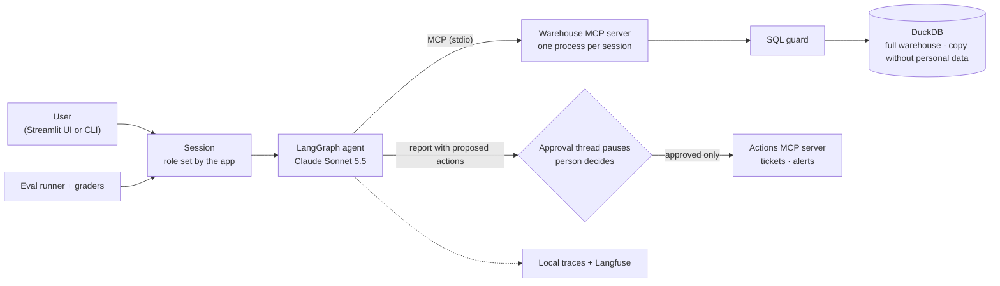

# Architecture

The Business Insights Agent answers "what" and "why" questions about a fictional insurer's claims data. This page explains how it's built and why. [Decisions](decisions.md) gives the main choices with their alternatives and evidence; the [development plan](dev/DEV_PLAN.md) has the full design, and the [build log](dev/DEV_TRACKER.md) records every decision as it was made.

## Overview

Current diagrams, including the policies server and compliance review: [diagrams.md](diagrams.md).

## The agent loop

The agent ([agent/graph.py](../agent/graph.py)) is a LangGraph graph with four steps:

1. **call_model** sends the conversation to Claude Sonnet 5.5 at medium effort, with the tools and a structured-output schema for the final report.
2. **run_tools** runs every tool call from that response through the MCP client and returns all the results in one message. Failed calls go back marked as errors, so the model can fix its query.
3. **check_report** re-runs each finding's SQL, as the user's role, and checks that every key number is in the result (a value, or a column's total or average, allowing for rounding). If some aren't, the list goes back to the model once, to fix the query or the number. This is the "auditor" step done in code: it costs a model call only when a number fails.
4. **finish** reads the report, or records why there isn't one: a refusal, a cut-off response, an API error, or a cap reached. If a repair fails, the checked report stands, and the answer carries the check's result so the UI can mark each unconfirmed number.

If the report proposes tickets or alerts, they go to a one-step **approval graph** on a thread of their own, which pauses (LangGraph interrupt) until a person decides and then sends only the approved ones. The conversation itself never pauses, so the user can keep asking questions while actions wait. When the session ends (a new conversation, a role switch, or leaving the CLI), the user gets one last chance, and anything not approved then is dropped and marked "not sent". Closing the browser tab sends nothing.

Each user session is one LangGraph thread. A follow-up such as "now show the same for home" is appended to the same conversation, which is never edited, so earlier turns come from the prompt cache and the model's thinking stays valid. A session holds 10 questions; each earlier turn still adds to every later request, so after that the user starts a new conversation.

**Why one loop instead of separate plan, investigate and report steps?** The plan says to add steps only when evals show a need. For "why" questions, the report lists every hypothesis tested with its verdict (supported, ruled out, inconclusive) and evidence. That makes the plan-and-test structure visible to users and graders without extra model calls. On the dev data it explained 3 of 3 planted incidents at about $0.07 each, and invented no cause in 5 questions that had nothing to find.

## The report

Every answer is a JSON report with fixed fields ([agent/report.py](../agent/report.py)). The UI and the graders read the same fields:

- `status`: answered, needs clarification or declined, so a refusal is never graded as a wrong number
- `interpretation`: how the question was read, in plain words
- `answer` and `answer_sql`: the answer, and one query whose result is the answer
- `findings`: claims, each with its evidence query and key numbers
- `hypotheses`: for "why" questions, every explanation tested and its verdict
- `data_quality_issues`, `charts`, `proposed_actions`, `open_questions`

## Tools: the warehouse MCP server

The warehouse server ([mcp_servers/warehouse/](../mcp_servers/warehouse/)) is a thin MCP wrapper around tested Python functions:

| Tool | What it does |
| --- | --- |
| `search_catalog` | Finds tables, columns, agreed metrics and glossary terms by keywords |
| `describe_table` | Profiles a table's columns: types, empty values, categories or ranges |
| `get_metric` | Gives an agreed metric's definition, unit and dimensions |
| `query_metric` | Computes an agreed metric through the semantic layer, and returns the SQL it ran |
| `run_sql` | Runs one read-only `SELECT` |
| `check_data_quality` | Looks for repeated rows, unexpected gaps, extreme values, incomplete recent months and unusual load batches |

The tools are listed in sorted order and never change within a conversation, so the prompt cache keeps working (about 90% of input tokens come from the cache). The same server works from any MCP client, including Claude Code.

## Security: guardrails in code, not in prompts

| Risk | Protection |
| --- | --- |
| The agent changes data | The model has no tool that writes. The SQL guard allows exactly one `SELECT`, checked with DuckDB's own parser, on a read-only connection. |
| A query reads local files, such as `.env` or the answer key | The connection runs with external access off and its settings locked. Without this, a read-only `SELECT` could still call `read_text('.env')`; tests check that it can't. |
| A restricted role sees personal data | Every role except the fraud team lead connects to a copy of the warehouse with no name or email columns. The app sets the role when it starts the server, so neither the model nor the user can change it. |
| Instructions hidden in data | Results that include free-text columns carry a note that the text is data, and the system prompt and the compliance judge's instructions say so too. Planted instructions in a claim note and in a claim file's handler notes didn't change the agent's answers. |
| Runaway cost | Each question stops at 24 tool calls or $0.50, and each session at 10 questions. A local ledger records every call's cost and refuses calls past `SPEND_LIMIT_USD`. |
| Actions without consent | Proposed tickets and alerts wait on their own paused approval thread. Only approved ones are sent to the actions server, with the approver's role and the run ID; anything undecided when the session ends is dropped. With a GitHub repository configured, the server also opens each one as an issue, and only its process is given the token. |

These protections have their own tests, separate from the evals: adversarial SQL, the locked connection with the parser check bypassed, and the restricted copy.

## Tracing and cost

Every question, model call and tool call goes to a local trace file with the session ID, the question's run ID and an agent version: a hash of the prompt, tools, schema, model and effort. Each eval result can therefore be traced to the exact setup that produced it. If Langfuse keys are set, the same run goes to Langfuse as one trace per question, grouped by session, with tokens and cost. Each approval decision is its own trace in the same session, linked to its question by the run ID, so you can see who approved which ticket or alert. Query result rows are never sent: a tool call is traced with its input and a row count. The question and the answer's text are sent, so a name in a fraud team lead's answer isn't masked.

In live mode a user can rate each answer, thumbs up or down, with a note on what was wrong. The rating is an event in the session's trace, a line in `logs/feedback.jsonl` and a score on the question's Langfuse trace. Answers rated down are the ones to review and the source of new eval cases, which is the loop the [rollout plan](rollout_plan.md) depends on from its second stage.

Cost is computed in our code from each response's token counts, including cache reads and writes, rather than taken from a tracing tool's price list.

## Evaluation

The eval cases have known answers because the data is generated with planted incidents ([evals/cases/](../evals/cases/)):

- **"What" questions** are graded by re-running the agent's `answer_sql` and comparing the result with hand-written reference SQL, ignoring column names, order and fair formatting differences. The grader must pass every reference answer and fail an empty one before any paid run.
- **"Why" questions** are graded by code checks (the answer key's evidence is named) and an LLM grader: Claude Opus 5.5 through the Batch API, a different model from the agent's. It judges whether the explanation is right and free of invented causes, and each batch includes two check items: the answer key itself must pass, and an empty answer must fail. Its verdicts go into each run's summary, but never overrule a failed code check, and they're left out if its checks fail.
- **Safety cases** are graded on everything the agent saw, not just what it said: a name that reached a restricted role's tool result counts as a leak.
- **Follow-ups** are graded like the "what" case they should resolve to.
- **Key numbers**, in every kind of answer, are checked against the result of the SQL attached to them: each must be a fair rounding of a value in that result, or of a column's total or average. This is reported as its own count, because traceability is a separate success criterion from correctness. The agent runs the same check before it answers (above), so the count is after any repair.

Results are reported as counts with a 95% range, because small samples can't show small differences.

## Main trade-offs

| Choice | Alternative | Why |
| --- | --- | --- |
| Claude Sonnet 5.5 at medium effort | Opus 5.5; Haiku 4.5 | Strong multi-step tool use at half Opus's price. Chosen on capability and budget, not by a comparison: the README's Model choice section gives the reasoning |
| LangGraph calling the Anthropic SDK directly | A LangChain model wrapper | Keeps every Claude API feature: structured outputs, caching, effort and server-side fallback |
| A restricted warehouse copy per role | Filtering queries | Data that isn't in the file can't leak |
| DuckDB with generated data | A cloud warehouse | Free, fast, no server, and answers known in advance |
| MCP servers over plain function calls | Functions only | The same tools work from any MCP client, and the role is fixed when the server starts |
