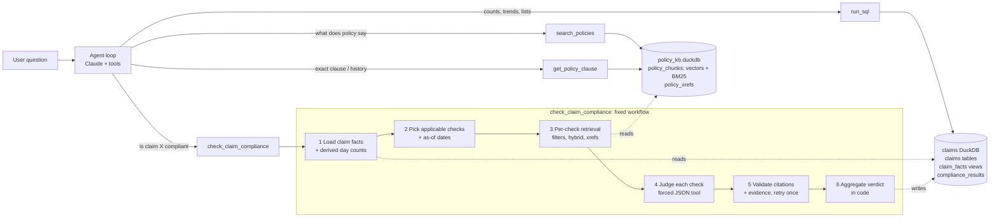

# Policy-Compliance RAG — Architecture and Build Plan

**Project:** insurance claims analytics agent
**Adds:** the ability to judge whether claims comply with company policy, with citations
**Written:** 16 Oct 2026, to be built in Claude Code
**Assumed stack:** Python 3.11+, DuckDB 1.5, Claude via the Anthropic SDK with tool use, fastembed for embeddings. Runs locally, with no agent framework. The full list of assumptions about your existing code is in `CLAIM_FACTS_CONTRACT.md` §3.

---

## How RAG fits, in one paragraph

**RAG supplies the rules, SQL supplies the facts, the model applies one to the
other, and code checks the model's work.** The agent gets three new tools next
to `run_sql`:
- `search_policies` and `get_policy_clause` answer policy questions.
- `check_claim_compliance` runs a fixed review workflow on one claim. It loads
  the claim's facts from DuckDB and works out which policy versions were in
  force. For each of ten checks, it retrieves the relevant clauses and asks
  the model to judge the claim against those clauses only. It then validates
  every citation in code and aggregates a verdict.

Claims, policy chunks, vectors, the BM25 index and stored verdicts all live in
DuckDB.

---

## 0. Decisions at a glance

| Decision | Choice | Why | Revisit if |
|---|---|---|---|
| Unit of retrieval | One clause (`### N.M` heading) = one chunk: 252 chunks, almost all under 130 words (the largest is the DOC-005 Appendix A table, at about 460 words) | The citation unit and the retrieval unit are the same thing. Clauses are already the right size. | Never for policy text |
| Store | DuckDB, in a separate file `data/policy_kb.duckdb` rebuilt from markdown | Same engine as the claims data. Metadata filters are plain `WHERE` clauses. | — |
| Vector search | Brute force `array_cosine_similarity` on `FLOAT[384]`, with **no HNSW index** | 252 rows takes microseconds. VSS index persistence is still experimental in DuckDB 1.5 and the docs advise against it in production. Heavy metadata filtering is simpler and exact without an index. | More than about 100k chunks |
| Embedding model | `BAAI/bge-small-en-v1.5` via **fastembed** (384-d, local, ONNX, no API key) | Runs offline, free and deterministic. A small corpus doesn't need a large model. | Hybrid recall@8 below 0.90 on the retrieval eval |
| Lexical search | DuckDB FTS (BM25) with a **digit-preserving** `ignore` regex and code normalisation | Policy text is full of exact tokens (`D-04`, `RS-01`, `0.05`, `AUD 5,000`) that embeddings handle badly. The default FTS regex **drops digits**. | — |
| Fusion | Reciprocal Rank Fusion (k = 60) of the top 30 vector and top 30 BM25 results | No score calibration needed, and robust | Exact-code questions miss: weight BM25 ×2 when the query contains a code |
| Filters | Claim type, document scope, and **version in force**: the incident date for coverage and settlement documents, the decision date for procedures | Policies change. GC-009 and GC-010 have identical facts and opposite verdicts. | — |
| Context expansion | One hop along clause-level cross-references | Rules span documents (MTR-002 3.6 → STL-007 3.4) | — |
| Reranker | None in v1 | It hasn't earned its place at 252 chunks | Eval shows the right clause retrieved but buried |
| Agent integration | Three new tools; routing by tool descriptions and system-prompt rules; no router model, no framework | Four tools is well within what the model routes reliably | Routing eval below 14/16 |
| Compliance engine | **Fixed workflow** with a 10-check checklist, per-check retrieval and per-check judge calls in parallel. The verdict is aggregated **in code**. | Compliance must be exhaustive and repeatable. A free-roaming agent skips checks. | — |
| Output | JSON verdict. Every finding has clause IDs and evidence values. A validator rejects citations that weren't retrieved. | Citations are enforced in code, not just requested in a prompt | — |
| Evaluation | 27 golden claims, 35 retrieval questions, 16 routing questions. Compare naive RAG, checklist RAG and full-context. | Measured, not assumed | — |

---

## 1. What the agent will be able to do

| Capability | Example | Tools used |
|---|---|---|
| Policy Q&A with citations | "What excess applies to a 22-year-old driver?" | `search_policies` |
| Exact clause lookup and history | "Did clause 3.4 of the motor policy change this year?" | `get_policy_clause` |
| Single-claim compliance review | "Does claim GC-010 comply with policy?" | `check_claim_compliance` |
| Portfolio compliance (policy + data) | "Which Q3 claims were settled above the approver's authority?" | `search_policies`, then `run_sql` |
| Compliance analytics | "What were the most common breach types in Q3?" | `run_sql` over `compliance_results` |
| Existing analytics (unchanged) | "Why are this quarter's claims higher than usual?" | `run_sql` |

---

## 2. Architecture



**Where state lives**
- `policies/*.md`: the source of truth. Edit these; never edit the KB tables.
- `data/policy_kb.duckdb`: a derived artefact, rebuilt by the ingest command.
  The retrieval module opens it directly. Keep it separate from the claims
  database so `run_sql` can't query raw chunks and bypass the citation rules.
- Claims DuckDB: your existing tables, plus the new `golden_claim_facts`,
  `nsw_public_holidays`, the views `claim_facts` and `claim_facts_derived`,
  and the table `compliance_results`.
- `logs/llm_calls.jsonl`: one line per model call (build step 0).

---

## 3. The knowledge base

Meridian General Insurance is fictional. The kit has eight documents: seven
active and one superseded.

| Document | Title | Version | In force | Version basis | Chunks |
|---|---|---|---|---|---|
| POL-CLM-001 | Claims Handling Procedure | 4.2 | from 2026-01-01 | decision date | 36 |
| POL-MTR-002 | Motor Coverage and Exclusions | **6.0** | from 2026-03-01 | incident date | 42 |
| POL-MTR-002 | Motor Coverage and Exclusions | **5.3 (superseded)** | 2025-03-01 to 2026-02-28 | incident date | 41 |
| POL-AUT-003 | Delegated Authority | 3.1 | from 2026-02-01 | decision date | 23 |
| POL-FRD-004 | Fraud Indicators and Referral | 5.1 | from 2026-01-15 (review overdue) | decision date | 25 |
| POL-DOC-005 | Documentation Requirements | 2.4 | from 2026-01-01 | decision date | 33 |
| POL-SLA-006 | Service Levels | 1.3 | from 2026-01-01 | decision date | 23 |
| POL-STL-007 | Settlement and Excess | 3.0 | from 2026-01-01 | incident date | 29 |
| **Total** | | | | | **252** |

That is about 9,600 words of clause text, or about 15k tokens for all eight
files.

**Writing conventions (the ingest code relies on them):**
- YAML front matter: `doc_id`, `version`, `effective_from`, `effective_to`
  (exclusive, `null` if current), `version_basis`
  (`incident_date` / `action_date`), `status`, `applies_to_claim_types`,
  `review_date`, `policy_family`.
- `## N. Section` and `### N.M Clause title`. Clause numbers are unique
  within a document version.
- Exclusion clause titles end in `— ABSOLUTE` or `— REBUTTABLE`. Ingest copies
  this into an `exclusion_type` column.
- Cross-references are written as `POL-XXX-NNN clause N.M`, `clause N.M`
  (same document) or `section N`. All 104 resolve.
- `## Appendix A` in DOC-005 has no `###` children, so it becomes one chunk
  with clause id `A`.

**The deliberate edge cases are listed in Appendix A of this plan.** Each one
is tested by at least one golden claim or retrieval question.

---

## 4. Ingestion and chunking

### 4.1 Rules
1. Parse the front matter into a `policy_documents` row.
2. Make one chunk per `### N.M` heading. The chunk text runs to the next
   heading of level 3 or above. Strip trailing `---` lines.
3. Make one chunk per `## Appendix X` section that has no `###` children
   (clause = `X`).
4. The `#` title, the superseded-notice blockquote and section intro lines are
   not chunks. The superseded notice goes into the breadcrumb (rule 5).
5. Build a **breadcrumb header** and prepend it to the text to make
   `context_text`. This is what gets embedded and shown to the model:
   `POL-MTR-002 Motor Vehicle Coverage and Exclusions (v5.3, SUPERSEDED: applies to incidents before 2026-03-01) > 3. Exclusions > 3.4 Unlicensed driving — ABSOLUTE`
6. `search_text` = `normalise(context_text)` (§4.3). This is what BM25
   indexes.
7. Extract cross-references with regex. Store **clause-level** links in
   `policy_xrefs`. Don't store section-level references (`section 3`): they
   would expand to up to 18 chunks.
8. IDs: `chunk_id = 'POL-MTR-002@5.3:3.4'` (unique) and
   `clause_id = 'POL-MTR-002:3.4'` (shared across versions).

### 4.2 Tables (`data/policy_kb.duckdb`)
```sql
CREATE TABLE policy_documents (
  doc_id VARCHAR, version VARCHAR, title VARCHAR, policy_family VARCHAR,
  status VARCHAR, version_basis VARCHAR, effective_from DATE, effective_to DATE,
  review_date DATE, applies_to_claim_types VARCHAR[], owner VARCHAR, source_path VARCHAR,
  PRIMARY KEY (doc_id, version));

CREATE TABLE policy_chunks (
  chunk_id VARCHAR PRIMARY KEY,          -- POL-MTR-002@5.3:3.4
  clause_id VARCHAR,                      -- POL-MTR-002:3.4
  doc_id VARCHAR, version VARCHAR, doc_title VARCHAR,
  section_title VARCHAR, clause_title VARCHAR,
  exclusion_type VARCHAR,                 -- ABSOLUTE | REBUTTABLE | NULL
  policy_family VARCHAR, applies_to_claim_types VARCHAR[],
  status VARCHAR, version_basis VARCHAR, effective_from DATE, effective_to DATE,
  text VARCHAR,                           -- clause as written
  context_text VARCHAR,                   -- breadcrumb + text (embedded, shown to the model)
  search_text VARCHAR,                    -- normalised (BM25)
  embedding FLOAT[384]);

CREATE TABLE policy_xrefs (from_chunk_id VARCHAR, to_clause_id VARCHAR);
```

### 4.3 Normalising text for BM25 (apply the same function to queries)
```python
import re
def normalise(t: str) -> str:
    t = re.sub(r"POL-([A-Z]{3})-(\d{3})", lambda m: f"pol{m[1]}{m[2]}", t)  # POL-MTR-002 -> polMTR002
    t = re.sub(r"\b([A-Z]{1,3})-(\d{2})\b", r"\1\2", t)                     # D-04 -> D04, RS-01 -> RS01
    t = re.sub(r"(\d),(\d{3})\b", r"\1\2", t)                               # 5,000 -> 5000
    return t.lower()
```

### 4.4 Done when
The per-document chunk counts match §3 (total **252**). Every clause-level
cross-reference resolves to an existing `clause_id`. Re-running ingest is
idempotent.

---

## 5. Claim facts

The compliance tool reads one row from `claim_facts_derived`. All 80 fields,
the derived columns, the business-day macro and the assumptions about your
current schema are in **`CLAIM_FACTS_CONTRACT.md`**. The core rule:

> **Claim-side facts are computed in SQL. Policy-side rules come only from
> retrieved clauses.** SQL computes day counts, business days, payment totals
> and repair-cost-to-value percentage. It never computes authority limits,
> fraud scores, excess amounts or thresholds, because those must come from
> the policy text. The model never does date arithmetic, and every number
> has a single source of truth.

Two as-of dates are derived per claim. `coverage_as_of = incident_date`
selects MTR-002 and STL-007. `procedure_as_of = decision_date` selects the
other five documents.

The business-day macro in the contract was run on DuckDB 1.5.6. It matches an
independent Python calendar on all 27 golden claims × 5 measures.

---

## 6. Embeddings, BM25 and retrieval

### 6.1 Embeddings
```python
from fastembed import TextEmbedding
model = TextEmbedding("BAAI/bge-small-en-v1.5")            # 384-d; small download on first run
chunk_vecs = list(model.passage_embed(context_texts))      # at ingest
query_vec  = next(model.query_embed([query]))              # at query time
```
Method names are from fastembed's `TextEmbedding` API; adjust if your installed
version differs. Wrap these calls in one module (`embed.py`) so changing the
model touches one line. Re-embed everything when the model changes, because the vector
dimension is part of the column type.

### 6.2 BM25 index
```sql
INSTALL fts; LOAD fts;
PRAGMA create_fts_index('policy_chunks', 'chunk_id', 'search_text',
    stemmer = 'porter', stopwords = 'english',
    ignore = '(\\.|[^a-z0-9])+',     -- default is '(\\.|[^a-z])+', which drops every digit
    overwrite = 1);
```
The index does not update when the table changes, so rebuild it at the end of
every ingest.

**Sanity check:** a BM25 search for `normalise('D-04')` must return exactly
three chunks: `POL-FRD-004:2.4`, `POL-FRD-004:5.1` and `POL-DOC-005:8.2`.
With the default regex it returns nothing useful.

### 6.3 Hybrid query (one SQL statement)
```sql
WITH eligible AS (
  SELECT c.* FROM policy_chunks c
  WHERE list_contains(c.applies_to_claim_types, $claim_type)
    AND ($doc_scope IS NULL OR list_contains($doc_scope, c.doc_id))
    AND (CASE c.version_basis WHEN 'incident_date' THEN $coverage_as_of ELSE $procedure_as_of END) >= c.effective_from
    AND (c.effective_to IS NULL OR
         (CASE c.version_basis WHEN 'incident_date' THEN $coverage_as_of ELSE $procedure_as_of END) < c.effective_to)
),
vec AS (
  SELECT chunk_id, row_number() OVER (ORDER BY array_cosine_similarity(embedding, $q_vec::FLOAT[384]) DESC) AS r
  FROM eligible QUALIFY r <= 30
),
bm25 AS (
  SELECT chunk_id, row_number() OVER (ORDER BY score DESC) AS r
  FROM (SELECT chunk_id,
               fts_main_policy_chunks.match_bm25(chunk_id, $q_text, fields := 'search_text') AS score
        FROM eligible)
  WHERE score IS NOT NULL QUALIFY r <= 30
)
SELECT e.chunk_id, e.clause_id, e.version, e.status, e.effective_from, e.effective_to,
       e.context_text, sum(1.0 / (60 + f.r)) AS rrf
FROM (SELECT * FROM vec UNION ALL SELECT * FROM bm25) f
JOIN eligible e USING (chunk_id)
GROUP BY ALL ORDER BY rrf DESC LIMIT $k;
```
For `search_policies` called by the outer agent, both as-of parameters equal
`as_of_date`, which defaults to today. Pass `$q_text` through `normalise()`.
The version filter, vector ranking, fusion and named parameters were run on
DuckDB 1.5.6 against the real chunks. A claim dated 2026-02-10 receives only
v5.3 motor clauses and one dated 2026-06-16 only v6.0. The BM25 CTE follows
the DuckDB 1.5 FTS docs; FTS couldn't be downloaded in my environment, so
**that part is untested**.

### 6.4 Exact lookup and cross-reference expansion
```sql
-- get_policy_clause: version in force on a date (or all versions)
SELECT * FROM policy_chunks
WHERE clause_id = $clause_id
  AND ($all_versions OR ($as_of >= effective_from AND (effective_to IS NULL OR $as_of < effective_to)))
ORDER BY effective_from;

-- 1-hop expansion of retrieved chunks, under the same as-of rule
SELECT DISTINCT t.* FROM policy_xrefs x
JOIN policy_chunks t ON t.clause_id = x.to_clause_id
WHERE list_contains($retrieved_chunk_ids, x.from_chunk_id)
  AND (CASE t.version_basis WHEN 'incident_date' THEN $coverage_as_of ELSE $procedure_as_of END) >= t.effective_from
  AND (t.effective_to IS NULL OR
       (CASE t.version_basis WHEN 'incident_date' THEN $coverage_as_of ELSE $procedure_as_of END) < t.effective_to);
```
`get_policy_clause` must normalise IDs: `POL-AUT-003 4.7`, `AUT-003 §4.7` and
`POL-AUT-003:4.7` all mean the same clause.

### 6.5 Parameters (start here; change only with eval evidence)
| Parameter | v1 value |
|---|---|
| Candidates per list (vector, BM25) | 30 |
| RRF k | 60 |
| `search_policies` top_k | 8 |
| Per-check top_k (before expansion) | 6 |
| Cross-reference expansion cap | 4 extra chunks per check |

### 6.6 Tuning knobs, in the order to try them, each only if the eval shows the problem
1. **Exact-code misses** (R-12, R-27, R-29): weight BM25 ranks ×2 in RRF
   when the query matches `[A-Z]{1,3}-\d{2}`.
2. **An anchor clause is missed for a check:** pin it in the checklist (§8.3).
   That is curation rather than retrieval, so record it as such.
3. **The right clause is retrieved but ranked low:** add a cross-encoder
   reranker on the top 20.
4. **Recall is still below 0.90:** try `BAAI/bge-base-en-v1.5` (768-d) or an
   API embedding model.

---

## 7. Tools and routing

### 7.1 Tool definitions (paste the descriptions as written)

```json
{
  "name": "search_policies",
  "description": "Search Meridian's internal policy knowledge base: claims handling, motor coverage and exclusions, delegated authority, fraud, documentation, service levels, settlement and excess. Returns the most relevant clauses with clause_id, version, effective dates and text.\nUse when: the user asks what a policy says or what a rule, limit or threshold is; or BEFORE writing SQL that applies a policy rule across many claims (fetch the rule, then cite it).\nDo not use for: counts, sums or trends in claims data (use run_sql); checking one specific claim (use check_claim_compliance).\nPolicies change over time. Pass as_of_date when the question concerns a past date or a specific incident. The default is today.\nAlways cite clause_ids from the results. If no result answers the question, say the policy base does not cover it.",
  "input_schema": {
    "type": "object",
    "properties": {
      "query": {"type": "string", "description": "Natural-language question or keywords. Clause codes like D-04 or RS-01 are fine."},
      "as_of_date": {"type": "string", "description": "YYYY-MM-DD. Returns clause versions in force on this date. Default: today."},
      "claim_type": {"type": "string", "enum": ["motor", "home", "liability", "travel"], "default": "motor"},
      "top_k": {"type": "integer", "minimum": 1, "maximum": 10, "default": 8}
    },
    "required": ["query"]
  }
}
```
```json
{
  "name": "get_policy_clause",
  "description": "Fetch the exact text of one clause by ID, e.g. 'POL-AUT-003:4.7' or 'POL-MTR-002:3.4'. Pass as_of_date for the version in force on that date, or all_versions=true to see how the clause changed over time. Use when a clause ID is already known (from the user, an earlier result or a cross-reference).",
  "input_schema": {
    "type": "object",
    "properties": {
      "clause_id": {"type": "string"},
      "as_of_date": {"type": "string", "description": "YYYY-MM-DD. Default: today."},
      "all_versions": {"type": "boolean", "default": false}
    },
    "required": ["clause_id"]
  }
}
```
```json
{
  "name": "check_claim_compliance",
  "description": "Run a full policy-compliance review of ONE claim. Loads the claim's facts, retrieves the policy clauses in force on its incident and decision dates, checks 10 areas (cover, notification, exclusions, triage, assessment, authority, fraud, documentation, service levels, settlement) and returns a structured verdict with findings and clause citations. Takes 10-30 seconds.\nUse when: the user asks whether a specific claim complies, was handled or paid correctly, or why it was flagged.\nDo not use for: questions across many claims (use search_policies for the rule, then run_sql); general policy questions (use search_policies).",
  "input_schema": {
    "type": "object",
    "properties": {"claim_id": {"type": "string"}},
    "required": ["claim_id"]
  }
}
```
Add this line to the existing `run_sql` description: *"For what policy
requires, call search_policies first and cite it. Per-claim compliance
verdicts are stored in table compliance_results."*

### 7.2 System-prompt addition
```text
## Policy and compliance
- Never state a policy rule, limit or threshold from memory. Every policy statement must cite a
  clause returned by a tool in this conversation, written as (POL-AUT-003 §2.1, v3.1).
- "Which claims breach X?": first search_policies for the rule, read the returned clauses for
  exceptions (for example catastrophe surge authority, endorsements, rebuttals), then run_sql
  applying the exact thresholds, then answer with the clause citation.
- One claim's compliance: call check_claim_compliance and summarise its findings. Do not
  re-judge them yourself.
- Questions about a past date or a specific incident: pass as_of_date.
- If the policy base does not cover the question, say so plainly.
```

### 7.3 Why there's no router model or framework
With four tools that have clear "use when" and "do not use for" lines, Claude
routes reliably. The routing eval (16 questions) measures it. Add machinery
only if that eval fails. The one composition pattern worth teaching
explicitly, **policy first, then SQL**, is in the system prompt and is tested
by T-04, T-08 and T-16.

---

## 8. The compliance workflow (`check_claim_compliance`)

### 8.1 v0: naive RAG (build first, as the baseline)
1. Turn the claim's non-blank facts into a summary string.
2. Use it as one query: top 8 across all documents, with the as-of filters.
3. One judge call covering all areas, using the same output schema.
4. Aggregate as in §8.2 step 6.

This will miss things. Its job is to give you a number to beat.

### 8.2 v1: checklist workflow
1. **Load facts.** Read the row from `claim_facts_derived`. Serialise it as
   JSON, with blanks as `null`.
2. **Plan.** Every check runs for every claim. The check itself returns
   `NOT_APPLICABLE` or `NOT_ASSESSED` where relevant, so nothing is skipped
   silently. Compute `coverage_as_of` and `procedure_as_of`.
3. **Retrieve per check.** Run one anchor query plus fact-triggered
   sub-queries (§8.3) through the hybrid search, with that check's
   `doc_scope`. Dedupe, keep the top 6, then add up to 4 one-hop
   cross-references.
4. **Judge per check, in parallel** (thread pool of 5, temperature 0). Use the
   prompt in §8.4 and force the `record_check_result` tool (§8.5).
5. **Validate in code:**
   - Every cited `clause_id` must be in that check's retrieved set.
   - Every evidence key must be a claim-facts field with exactly that value.
     Computed values, such as an expected excess, belong in `calculation`,
     not in `evidence`.
   - Every BREACH or NEEDS_REVIEW finding must cite at least one clause and
     have a severity.

   On failure, retry once with the validator's error message. If it fails
   again, downgrade the finding to NEEDS_REVIEW and flag it
   `validation_failed`.
6. **Aggregate in code:**
   - Any BREACH: `NON_COMPLIANT`.
   - Otherwise, any NEEDS_REVIEW: `NEEDS_REVIEW`.
   - Otherwise: `COMPLIANT`.
7. **Persist** the verdict JSON, retrieved chunk IDs, token counts and latency
   to `compliance_results`, and log every model call.

### 8.3 The checklist
Triggers decide **what to fetch, never what to conclude**. Keep them loose:
over-fetching costs a few tokens, but under-fetching causes misses.

| Check | Doc scope | Anchor query (always) | Fact-triggered sub-queries |
|---|---|---|---|
| cover | CLM-001, MTR-002 | period of cover, waiting period, and what the {product_tier} product covers for {peril} | new policy or renewal lapse → "waiting period new policy"; tier ≠ COMP → "own damage under {tier}, uninsured motorist extension"; peril THEFT / MALICIOUS_DAMAGE → "{peril} cover conditions"; not in Australia → "territorial limit" |
| notification | CLM-001, AUT-003 | time limit for notifying a claim | days_incident_to_fnol > 7 → "late notification after {n} days, exceptions"; exception_applied → "approval required for exception {exception_applied}" |
| exclusions | MTR-002, AUT-003 | exclusions relevant to {peril} with vehicle use {vehicle_use_at_incident} | bac not blank → "blood alcohol limit {licence_type} licence"; drug test positive → "drug impairment"; licence_status ≠ VALID → "{licence_status} licence {n} days, renewed {m} days after"; use ≠ PRIVATE → "{use} use, endorsements {endorsements}"; driver_listed = N → "unlisted driver"; registration ≠ CURRENT → "unregistered vehicle {n} days"; exclusion_override → "setting aside exclusion {clause}, approval" |
| triage | CLM-001, FRD-004 | handling track criteria and precedence | injury → "injury claim handling track"; any fraud indicator → "fraud referral and triage" |
| assessment | CLM-001 | when an assessment is required, and its timeframes | claimed > 50k → "independent assessor, high value"; claimed and assessed differ → "second assessment variance" |
| authority | AUT-003, CLM-001 | settlement and denial authority limits by level | DENY → "denial authority and peer review"; payment_count > 1 → "authority per claim, split payments"; second approver or override or exception present → "dual approval triggers"; total_loss → "who may declare a total loss"; catastrophe_event_id → "catastrophe authority" |
| fraud | FRD-004 | fraud score bands and required actions | indicators present → "points and scoring for indicators {codes}"; always → "mandatory referral triggers" |
| documentation | DOC-005 | documents required before a {decision} decision on a {peril} claim | always add `get_policy_clause('POL-DOC-005:A')`; injury → "injury documents"; claimed > 10k → "documents required for a claim of AUD {claimed_amount}"; total_loss → "total loss documents"; exception or override → "evidence for exception or rebuttal" |
| service_levels | CLM-001, SLA-006 | claim timeframes: acknowledgement, decision, communication, payment, status updates | vulnerable → "vulnerable claimant updates"; catastrophe → "catastrophe timeframes"; track FAST → "fast-track decision deadline" |
| settlement | STL-007, MTR-002 | excess and settlement calculation for {product_tier}, {sum_insured_basis} value | driver present → "additional excess, driver aged {age}, full licence {n} years"; not at fault → "excess when not at fault, third party identified"; GST registered → "GST input tax credit settlement"; repair_cost_pct_of_value > 50 or total_loss → "total loss threshold"; not at fault → "recovery action" |

### 8.4 Judge prompt (system prompt for each check call)
```text
You are a claims compliance reviewer at Meridian General Insurance. You are reviewing ONE
compliance area for ONE claim.

<check>{check_id}: {check_description}</check>
<claim_facts>{claim facts JSON: every field, blanks as null, derived values included}</claim_facts>
<policy_clauses>
<clause id="{clause_id}" version="{version}" status="{status}" effective="{from}..{to}">
{context_text}
</clause>
...
</policy_clauses>

Rules:
1. Use ONLY the clauses above. If they do not contain a rule you need, return NEEDS_REVIEW and
   name the missing rule. Never rely on general insurance knowledge.
2. Claim facts are authoritative. Derived values (days, business days, totals, percentages) are
   already calculated. Use them exactly as given.
3. Coverage and settlement clauses apply by incident date; procedural clauses by decision date.
   Only clauses in force on the relevant date have been supplied.
4. An exception or rebuttal applies only if the facts show every condition is met AND the
   approval the policy requires is recorded.
5. An ABSOLUTE exclusion cannot be set aside by anyone. A recorded override of one is itself
   a breach.
6. Blank means "not applicable or not recorded". If a field you need is blank, return
   NOT_ASSESSED for that rule, unless the policy makes the absence itself a breach (for
   example, a required document not on file).
7. Report each distinct breach as its own finding. Cite at least one clause id for every
   BREACH or NEEDS_REVIEW. Copy the claim fields you relied on into evidence, using their exact
   names and values. Show any arithmetic step by step in calculation.
8. If nothing in this area is breached, return one PASS finding citing the clause(s) checked.

Severity: HIGH = the decision is void or must be reversed (absolute exclusion paid, outside
authority, mandatory denial ignored, fraud block bypassed). MEDIUM = wrong amount, required
step skipped, or service breach. LOW = a recording or scoring error that did not change the
outcome or the amount.

Record your result with the record_check_result tool.
```

### 8.5 Output tool (force it with `tool_choice={"type": "tool", "name": "record_check_result"}`)
```json
{
  "name": "record_check_result",
  "description": "Record the findings for one compliance check.",
  "input_schema": {
    "type": "object",
    "properties": {
      "check": {"type": "string"},
      "findings": {
        "type": "array",
        "items": {
          "type": "object",
          "properties": {
            "status": {"type": "string", "enum": ["PASS", "BREACH", "NEEDS_REVIEW", "NOT_APPLICABLE", "NOT_ASSESSED"]},
            "severity": {"type": "string", "enum": ["HIGH", "MEDIUM", "LOW"]},
            "rule": {"type": "string", "description": "One-line statement of the rule applied"},
            "clause_ids": {"type": "array", "items": {"type": "string"}},
            "evidence": {"type": "object", "description": "Claim-facts fields relied on, with their exact values"},
            "calculation": {"type": "string", "description": "Any arithmetic, step by step, e.g. '800 basic + 1,200 young driver = 2,000 expected; 800 applied'"},
            "explanation": {"type": "string", "description": "2-4 sentences"}
          },
          "required": ["status", "rule", "clause_ids", "evidence", "explanation"]
        }
      }
    },
    "required": ["check", "findings"]
  }
}
```

### 8.6 What a finding should look like (GC-010)
```json
{
  "check": "exclusions",
  "status": "BREACH",
  "severity": "HIGH",
  "rule": "For incidents before 2026-03-01, driving on an expired licence is an ABSOLUTE exclusion with no rebuttal.",
  "clause_ids": ["POL-MTR-002:3.4", "POL-AUT-003:4.3"],
  "evidence": {"incident_date": "2026-02-10", "licence_status": "EXPIRED", "licence_expired_days": 18,
               "exclusion_override": "POL-MTR-002:3.4", "decision": "ACCEPT"},
  "explanation": "The incident predates 1 March 2026, so POL-MTR-002 v5.3 governs. Under v5.3 clause 3.4 an expired licence is treated as no licence and no rebuttal is available. The exclusion was set aside with L3 and L4 approval, but POL-AUT-003 4.3 prohibits overriding an absolute exclusion at any level. The claim should have been denied."
}
```
For the single-call variants (v0, full-context, v1-single), use the same tool
but move `check` into each finding as an enum of the ten check names, so one
call can report findings for every area.

The overall verdict wraps the findings with `claim_id`, `overall`,
`as_of` (coverage and procedure), `policy_versions` used, `run_id`, `model`,
per-check `retrieved_chunk_ids`, token counts and `validation` flags.

### 8.7 Cost envelope per claim (input tokens, rough)
| Variant | Calls | Input tokens | Note |
|---|---|---|---|
| v0 naive | 1 | about 5k | Cheapest, least accurate (expected) |
| v1 checklist | 10 (parallel) | about 25–30k | Most debuggable: one call per check |
| v1-single (optional) | 1 | about 8–10k | Union of v1's retrieved clauses, one judge call |
| Full-context | 1 | about 17k | With prompt caching, the policy prefix is cheap after the first call |

At this corpus size, RAG is **not** the cheapest option (see §11).

---

## 9. Evaluation

### 9.1 Datasets (all in `eval/`)
| File | Contents |
|---|---|
| `golden_claims.csv` | 27 claims in the claim-facts shape. 20 are non-compliant. 7 are compliant: 4 traps (GC-003, 009, 016, 019) and 3 clean controls (GC-001, 026, 027). |
| `expected_verdicts.jsonl` | Per claim: expected overall verdict, 22 **required** findings in total, 8 **optional** knock-on findings, expected PASS citations, and what each case tests |
| `retrieval_questions.jsonl` | 35 questions: 32 scored for recall (semantic, exact code, version, cross-reference, synonym, multi-clause) and 3 checked at answer level (metadata, out of scope) |
| `routing_questions.jsonl` | 16 questions with required, any-of and forbidden tools |

How the golden labels were checked: every claim was built from one clean base
record with a single designed deviation. An independent rules engine was then
run over all 27. Its breaches match required plus optional findings exactly.
It caught two of my own labelling mistakes before you received the files.

### 9.2 Retrieval eval
- **recall@k** (k = 5 and 8): the share of `expected_clause_ids` in the top k.
  It is version-aware where `expected_versions` is set.
- **Version accuracy:** on version questions, zero chunks from the wrong
  version of that document.
- **MRR** of the first expected clause.
- **Ablation:** BM25 only, vector only, hybrid, hybrid plus cross-references,
  reported overall and by question `type`.
- **Targets:** hybrid recall@8 ≥ 0.90; version accuracy 100%; exact-code
  recall@5 = 1.0.

### 9.3 Compliance eval
**Matching rule (by clause, not by check name).** An expected finding is
detected if some predicted BREACH finding cites at least one clause in its
`must_cite_any ∪ also_acceptable`, version-matched where `version` is given.
One predicted finding can detect several expected ones. Report agreement on
the `check` name separately. Single-call variants pick their own labels, and
this keeps the comparison fair.

| Metric | Definition | Target |
|---|---|---|
| Overall accuracy | Predicted overall verdict equals expected (NEEDS_REVIEW counts as wrong) | ≥ 23/27 |
| Required-finding recall | Detected required findings out of 22 | ≥ 20/22 |
| Strict citation rate | Detected findings that cite a `must_cite_any` clause | ≥ 0.90 |
| False-positive breaches | Predicted BREACHes matching no required or optional finding | ≤ 3 in total |
| Traps and controls | The 7 compliant claims judged COMPLIANT | 7/7 |
| Hallucinated citations | Cited IDs that don't exist in the KB | 0 (tests the validator) |
| PASS grounding | Expected PASS findings that cite the expected clause | Report only |
| Cost | Tokens and seconds per claim | Report only |

Run each configuration **3 times** and report the mean and range. Even at
temperature 0, outputs vary.

### 9.4 Routing eval
A question passes if every `required_tools` entry was called, at least one
`any_of_tools` entry was called (where listed), and no `forbidden_tools` entry
was called. Target: 14/16 or better.

### 9.5 Baselines
| Config | What it is |
|---|---|
| v0 naive RAG | §8.1 |
| v1 checklist RAG | §8.2 |
| Full-context | All 8 policy files, both MTR-002 versions, in the prompt. Same facts and schema. One call. |
| v1-single (optional) | v1 retrieval with one judge call |

My expectation, to test rather than assume:
- v0 will miss the version-dependent and cross-document findings (GC-010,
  GC-014, GC-025).
- Full-context will be strong on accuracy but loose on citations.
- v1 should match it on recall with better citation precision and cleaner
  failure diagnosis.

If full-context wins outright, that's a valid finding. Write it up honestly
(§11).

### 9.6 Logs and the failure file
- `logs/llm_calls.jsonl`: one line per model call with `ts`, `run_id`,
  `component` (agent / judge / baseline), `model`, input and output tokens,
  `latency_ms`, tool calls and retrieved chunk IDs.
- `eval/failures.jsonl`: every eval miss is appended automatically with
  `run_id`, case, expected, got, retrieved IDs and a **diagnosis**:
  - `retrieval_miss`: the expected clause wasn't in the retrieved set. Fix
    retrieval (§6.6).
  - `wrong_version`: a clause from the wrong version was retrieved. Check the
    as-of logic.
  - `judge_error`: the clause was retrieved and the judgement was still
    wrong. Fix the prompt or rules, or consider a stronger model.
  - `validator_reject`: the model cited something it wasn't given.
  - `data_issue`: the golden facts are wrong. Fix the data, and record it.

  This file grows into your most valuable eval asset.

---

## 10. Build order (each step: a prompt for Claude Code and a "done when" you can check)

Paste each prompt into Claude Code as written. Don't start a step until the
previous step's "done when" passes.

**Step 0: Logging and setup** (½ day)
> Read docs/RAG_PLAN.md and docs/CLAIM_FACTS_CONTRACT.md fully. Add dependencies: duckdb, fastembed, pyyaml (and anthropic if missing). Add a wrapper so every LLM call the agent makes appends one JSON line to logs/llm_calls.jsonl with the fields in RAG_PLAN §9.6. Don't change agent behaviour. Show me where the wrapper is applied.

*Done when:* asking the agent one existing demo question writes a line to
`logs/llm_calls.jsonl`.

**Step 1: Claim facts** (½ to 1 day)
> Implement CLAIM_FACTS_CONTRACT.md §4–5: load eval/golden_claims.csv into golden_claim_facts and data/nsw_public_holidays_2025_2026.csv into nsw_public_holidays; create the bd_between macro and the claim_facts / claim_facts_derived views. Then compare our existing claims tables with the contract: list which T1 and T2 fields we lack, map what we have, and extend the mock data generator to populate the T1 fields with realistic values.

*Done when:* `SELECT claim_id, days_incident_to_fnol, bd_lodgement_to_ack
FROM claim_facts_derived WHERE claim_id IN ('GC-002','GC-003','GC-018')`
returns (104, 1), (120, 1) and (1, 5).

**Step 2: Ingest and chunk** (½ day)
> Implement RAG_PLAN §4 exactly: parse policies/*.md into data/policy_kb.duckdb tables policy_documents, policy_chunks (no embeddings yet) and policy_xrefs. Print chunk counts per document and the number of unresolved cross-references. Make it idempotent.

*Done when:* the counts match §3 (total 252), there are 0 unresolved
cross-references, and the `context_text` of `POL-MTR-002@5.3:3.4` starts with
the SUPERSEDED breadcrumb.

**Step 3: Embeddings and BM25** (½ day)
> Implement RAG_PLAN §6.1–6.2: embed context_text with fastembed BAAI/bge-small-en-v1.5 into FLOAT[384]; build the FTS index on search_text with the digit-preserving ignore regex; implement normalise() and apply it to index text and queries.

*Done when:* no chunk has a NULL embedding, and BM25 for `D-04` returns
exactly POL-FRD-004:2.4, POL-FRD-004:5.1 and POL-DOC-005:8.2.

**Step 4: Search tools and retrieval eval** (1 day)
> Implement search_policies and get_policy_clause (RAG_PLAN §6.3–6.4), then eval/run_retrieval_eval.py per §9.2 comparing bm25-only, vector-only, hybrid and hybrid+xrefs. Write a markdown results table to eval/results/ and append misses to eval/failures.jsonl.

*Done when:* the results table exists, hybrid recall@8 ≥ 0.90, and the five
version questions (R-02, R-03, R-08, R-09, R-31) are 5/5. If not, read failures.jsonl before changing anything.

**Step 5: Wire into the agent** (½ day)
> Register search_policies and get_policy_clause with the exact descriptions in RAG_PLAN §7.1, add the §7.2 system-prompt rules, and build eval/run_routing_eval.py over eval/routing_questions.jsonl.

*Done when:* routing passes 14/16 or better, and policy answers carry clause
citations.

**Step 6: Compliance v0 baseline** (½ day)
> Implement check_claim_compliance v0 (RAG_PLAN §8.1) using the §8.4 prompt and the §8.5 output tool, plus eval/run_compliance_eval.py implementing every metric in §9.3. Run it on all 27 golden claims, 3 runs.

*Done when:* the results table exists. A mediocre score is expected and fine.

**Step 7: Compliance v1 checklist** (1–2 days)
> Implement v1 per RAG_PLAN §8.2–8.3: checklist, fact-triggered sub-queries, coverage vs procedure as-of dates, 1-hop xref expansion, parallel per-check judge calls, validator with one retry, code aggregation, and the compliance_results table. Register it as an agent tool (§7.1). Re-run the compliance eval and put v0 and v1 side by side.

*Done when:* overall ≥ 23/27, required recall ≥ 20/22, traps and controls
7/7, and 0 hallucinated citations.

**Step 8: Full-context baseline** (½ day)
> Implement the full-context baseline (§9.5) with prompt caching on the policy block; add it as a column in the compliance report with tokens and seconds per claim.

*Done when:* one table compares v0, v1 and full-context on every §9.3 metric.

**Step 9: Portfolio compliance** (½ day)
> Batch-run check_claim_compliance over every claim lodged in Q3 2026, storing results in compliance_results. Make sure the agent can answer "What were the most common breach types in Q3?" via run_sql with citations.

*Done when:* that question returns counts by check and severity, citing the
clauses involved.

**Step 10: Demo polish** (½ day)
> Script the §12 demo questions; save transcripts and the eval tables to docs/demo/.

---

## 11. Honest trade-offs

- **Is RAG needed at about 15k tokens of policy?** Not for capacity: the
  whole corpus fits in context. RAG earns its place here through four things:
  - **version control by date** (the right version of a clause, not both);
  - **clause-level citations enforced in code**;
  - **per-check debuggability** (`retrieval_miss` versus `judge_error`);
  - **scale**, because a real insurer's policy library is thousands of pages.

  Step 8 measures whether accuracy justifies the extra calls. Report that
  with numbers.
- **The judge is an LLM.** For the handful of rules that are pure arithmetic
  (authority limits, excess), a deterministic check would be more reliable.
  The upgrade path is to extract thresholds from clauses into a reviewed
  rules table and run them in SQL alongside the judge, flagging disagreements.
  That's a stretch goal, not v1.
- **Mock data shapes the result.** The golden claims each have one designed
  deviation. Real claims have several and messy notes. If you extend your
  generator with seeded violations, store the seeded label in a column that
  is **excluded** from `claim_facts`, so the judge can't see the answer.
- **Duplicated statements.** SLA-006 4.1 restates CLM-001 timeframes, so
  retrieval may surface either. 4.2 says the source clause governs. Expected
  findings accept both.
- **Stale policy.** POL-FRD-004 is past its review date (2026-07-15) but still
  active. The agent should apply it and may mention the overdue review, but
  must not treat it as a claim breach.

---

## 12. Demo script and talking points

| # | Ask | Shows |
|---|---|---|
| 1 | "How many motor claims did we settle in Q3 2026, and what did we pay?" | Existing SQL path unchanged |
| 2 | "What's our rule on drivers with an expired licence? Did it change this year?" | Cited policy Q&A plus version history |
| 3 | "Check GC-009 and GC-010. Why did one pass and the other fail?" | Point-in-time retrieval: same facts, opposite verdicts |
| 4 | "Was the excess on GC-014 right?" | Calculation finding across two documents |
| 5 | "Which Q3 claims were settled above the approver's authority?" | Policy then SQL composition. Among the golden claims it must catch GC-004 and GC-005, and must not flag GC-019 (catastrophe surge). |
| 6 | "Run compliance on all Q3 claims. What are the most common breach types?" | Batch verdicts become queryable data |

Talking points:
1. Workflows where you need repeatability, agents where you need flexibility.
2. Claim-side facts in SQL, policy-side rules in RAG, so the model never does
   date maths.
3. Citations are enforced by a validator, not just requested in a prompt.
4. Every claim above is backed by an eval table: the retrieval ablation, v0
   versus v1 versus full-context, and the failure taxonomy.
5. Be honest about scale: long context is competitive at demo size, and here's
   the measurement.

---

## Appendix A: Deliberate edge cases

| Edge case | Where it lives | Tested by |
|---|---|---|
| Policy version changed mid-year | MTR-002 v5.3 → v6.0 (1.3, 2.6, 3.4, 4.2; history in 7.1) | GC-009 vs GC-010; R-02/03, R-08/09, R-32 |
| Threshold depends on another fact | MTR-002 3.2 (BAC 0.05 full licence, 0.00 provisional) | GC-008 |
| Absolute vs rebuttable exclusions; overrides | MTR-002 3.1, 6.1; AUT-003 4.3, 3.1(d) | GC-007, GC-009 |
| Endorsement removes an exclusion | MTR-002 3.7 + RS-01 | GC-015 vs GC-016 |
| Denial authority lower than settlement authority | AUT-003 2.3 | GC-006 |
| Authority is per claim, not per payment | AUT-003 2.2 | GC-005 |
| Catastrophe surge authority | AUT-003 4.7 | GC-019 (trap) |
| Track precedence (SIU → Complex → Fast → Standard) | CLM-001 3.2, 3.4 | GC-011, GC-012, GC-017 |
| Mandatory referral regardless of score | FRD-004 5.1 | GC-012 |
| Mutually exclusive indicators | FRD-004 7.1 | GC-013 |
| One policy tightens another | SLA-006 7.1 modifies CLM-001 6.2 | GC-025 |
| Waiver needs an identified at-fault party | STL-007 3.2 | GC-022 (waived), GC-019 (not waived) |
| Order of operations (ITC before excess) | STL-007 4.4 | GC-023 |
| Non-waivable document | DOC-005 4.3, 7.3 | GC-024 |
| Exception with dual approval | CLM-001 2.3; AUT-003 3.1(f) | GC-002 vs GC-003 |
| Near-threshold total loss (74.3% vs 75%) | STL-007 2.1 | GC-026 |
| Business days across a public holiday (Labour Day, 5 Oct) | SLA-006 2.1–2.2 | GC-018 |
| Policy past its review date | FRD-004 front matter | R-33 |
| Same rule stated in two places | SLA-006 4.1 vs source clauses (4.2 governs) | R-10 |
| Out of scope (no home coverage policy) | — | R-34, R-35 |

## Appendix B: Suggested layout in your repo
```
policies/                     # the 8 markdown policies (source of truth)
data/policy_kb.duckdb         # derived: rebuilt by ingest
data/nsw_public_holidays_2025_2026.csv
policy_rag/
  ingest.py   embed.py   retrieve.py   facts.py
  checklist.py   judge.py   validate.py   compliance.py   tools.py
eval/
  golden_claims.csv  expected_verdicts.jsonl  retrieval_questions.jsonl  routing_questions.jsonl
  run_retrieval_eval.py  run_compliance_eval.py  run_routing_eval.py
  results/   failures.jsonl
logs/llm_calls.jsonl
docs/RAG_PLAN.md  docs/CLAIM_FACTS_CONTRACT.md  docs/POLICY_KIT_README.md
```
