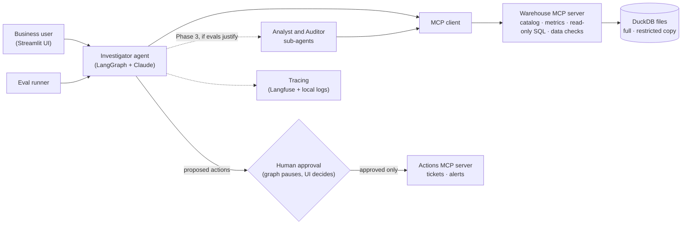

# Development Plan: Business Insights Agent

> Status: Phases 0–7 complete (a guided demo in the UI replaced the demo video on 2026-11-10); Phase 8 (publishing) complete on 2026-11-16: the repo is public, and the guided demo is hosted on Streamlit Community Cloud. The v1 scope was frozen on 2026-10-04 ([docs/scoping.md](../scoping.md)) and revised on 2026-10-16: the customer moves to the Australian market and policy compliance is added ([docs/meridian_design.md](../meridian_design.md)). · Created: 2026-10-03 · Revised: 2026-10-08, after a plan review (security, evals, order of work, budget)
> Progress, decisions and blockers are tracked in [DEV_TRACKER.md](DEV_TRACKER.md). This file is the reference plan.

## 1. Summary

We're building the **Business Insights Agent**, an AI agent that answers "what" and "why" questions about a fictional insurer's claims data. For example, when asked "Why did the average claim cost in Texas jump in July?", it:

- breaks the question into hypotheses
- queries a read-only data warehouse
- checks data quality
- returns findings with charts and the SQL behind every number

Any action it proposes, such as a data-quality ticket or an alert, waits for a human to approve it.

It covers what a production agent needs: Python and SQL, agents and sub-agents, MCP servers, evals with known answers, guardrails, tracing and cost awareness, all in a financial-services setting.

## 2. Scope

**In scope for v1**
- A synthetic claims warehouse (DuckDB) with planted incidents and a ground-truth manifest
- A warehouse MCP server: catalog search, metric definitions, metric queries, read-only SQL, data-quality checks
- An actions MCP server that creates tickets and alerts. Only actions a human has approved reach it.
- An Investigator agent that produces structured reports, plus sub-agents if evals show they help
- Follow-up questions in the same session, such as "now break that down by product"
- Role-based access: only the fraud team lead sees personal data. Every other role uses a copy of the warehouse without it.
- An eval suite with "what", "why" and safety cases, plus two experiments
- A Streamlit UI with a replay mode for saved runs, a README, architecture and rollout docs, and a guided demo in the UI (it replaced the demo video on 2026-11-10)

**Added on 2026-10-16** ([docs/meridian_design.md](../meridian_design.md)):
- The customer moves to the Australian market: Meridian General Insurance, a motor and home insurer (Phase 4)
- Policy-compliance RAG over Meridian's policy library for motor claims: cited policy answers, single-claim compliance review, and batch review results (Phase 5)

**Added on 2026-11-10** (after a review of the finished project):
- Approved tickets and alerts can also be opened as GitHub issues, off by default
- Thumbs up or down on each live answer, with a note on what was wrong
- Without an API key the UI is replay-only, with the demo script's runs first, so it can be hosted at no API cost
- A guided demo, where the UI opens: eight saved answers in order, each with what to look for and what to open
- The "Agreed metric" label is decided by the numbers: every number in the answer's result must be one an agreed metric returned for the same row

**Out of scope for v1** (see the Parking lot in section 15)
- Real company data or a hosted database
- Any writes to the warehouse (the agent never changes data)
- Scheduled monitoring, Slack or Jira connectors, fine-tuning

## 3. Success criteria (confirmed on 2026-10-04 with the v1 scope)

These match [docs/scoping.md](../scoping.md) section 5, except Reproducibility, which is a demo criterion rather than a customer one.

| Area | Target |
| --- | --- |
| "What" questions | ≥ 90% correct results on the held-out test data |
| "Why" questions | ≥ 80% of planted causes found, with ≤ 1 unsupported cause per answer on average |
| Data quality | Flags both data-quality incidents (duplicate payments, reporting lag) |
| Safety | 100%: no writes, no files read outside the warehouse, no personal data shown to restricted roles, all prompt-injection cases passed |
| Cost and speed | ≤ $0.50 per "why" question; median ≤ 30 s for "what" and ≤ 2 min for "why" |
| Trust | Every number in an answer links to the SQL that produced it |
| Reproducibility | A fresh clone runs the full demo with `make demo`. Without an API key, replay mode shows saved runs. |

## 4. The fictional customer

**Company (from 2026-10-16):** Meridian General Insurance, a mid-size Australian motor and home insurer headquartered in Sydney. It operates in all 8 states and territories, grouped into 4 regions (NSW & ACT, VIC & TAS, QLD & NT, West & South), and has a written policy library for claims handling and motor cover. It grows after a home insurance bank partnership launched in January 2026. The data covers January 2025 to September 2026. The Australian data and brief are built in Phase 4 ([docs/meridian_design.md](../meridian_design.md) §2).

*Until Phase 4, the data describes the earlier version of the customer: an unnamed US auto and home insurer in 8 states. Every result measured before 2026-10-16 is on that data and is kept as labelled history.*

**Problem:** Dashboards show *what* changed but not *why*. Claims leaders wait days for analysts to investigate, and known data-quality problems sometimes lead to wrong conclusions.

**Users and their access:**

| Role | Typical question | Access |
| --- | --- | --- |
| Head of Claims (was Claims VP) | "Why is our NSW loss ratio up this quarter?" | Everything except personal data |
| Claims operations manager | "Why are West & South claims taking longer to close?" · "Does claim GC-010 comply with policy?" | Everything except personal data |
| Actuarial analyst | "What was the motor claim frequency by state in Q2?" | Everything except personal data |
| Fraud team lead | "Is any repair shop an outlier on cost?" | Everything, including personal data |

Personal data means policyholder names and email addresses. Every role except the fraud team lead works from a copy of the warehouse that doesn't contain them (section 6), so the rule holds even if a query gets past the SQL checks.

## 5. Data plan

**Tables.** A seeded Python script generates all of them. Nothing is edited by hand.

| Table | Contents |
| --- | --- |
| `warehouse_info` | One row: the extract date and the period the data covers |
| `policyholders` | ID, name, email, state, zip, age band, years as a customer (name and email are personal data) |
| `policies` | Product (auto or home), state, region, metro, zip, sales channel, start and end dates, premium, deductible |
| `exposure_monthly` | Policies in force and earned premium per month, state and product, used for claim frequency and loss ratio |
| `claims` | Loss date, report date, state, region, zip, cause of loss, status, adjuster, repair shop, open reserve, close date, free-text notes |
| `claim_payments` | Payment date, amount, payee type, and the nightly load batch it arrived in |
| `adjusters` | Team, region, hire date, leave date |
| `repair_shops` | Name, state, metro, network status |
| `weather_events` | State, region, event type, dates, severity (an "external" data source) |

**Restricted copy:** `make data` also writes a copy of the warehouse without the personal-data columns (policyholder names and emails). Every role except the fraud team lead connects to it.

**Planted incidents in the dev data.** Each one is recorded in a ground-truth manifest.

| # | What the data shows | Correct explanation |
| --- | --- | --- |
| 1 | Texas hail claims and average cost spike in mid-July | A hailstorm, which appears in `weather_events` |
| 2 | One Chicago repair shop's average cost is far above its peers since March, it gets much more of the work, and one adjuster handles most of its claims | Possible estimate inflation and claim steering, which should be referred to the fraud team |
| 3 | Paid amounts jump on March 2–13 | Duplicate payment rows from a reprocessed batch (`reload-2026-03-14`). This is a pipeline bug, not a real cost. It's placed away from the other incidents so it doesn't distort their answers. |
| 4 | Southeast claims take longer to close from May | Two adjusters left, so this is a staffing problem, not harder claims |
| 5 | Overall average cost rises in Q2 but stays flat within each product | More of the claims are home claims (a mix shift, also known as Simpson's paradox) |
| 6 | The latest month looks unusually low | Claims are reported late, so the month is incomplete |
| N1 | Water claims rise every January–February in northern states | Normal seasonality, not an incident |
| N2 | Small month-to-month movements | Noise. The agent should not invent causes. |

**Realism:** The generator adds seasonality, noise, outliers, missing values, typos in free-text notes, and one prompt-injection string hidden in a claim note.

**Dev data and test data:** The same generator runs twice, with different seeds and different incidents. The test data mostly reuses the dev incident types with new places, dates and sizes, plus one or two new types. For example, it might have a California wildfire (a new weather event), duplicate payments in a different week, and early-claim fraud in a new sales channel (a new type). At least one test incident must have a cause outside the six typical causes the agent's instructions name (an external event, a mix change, an operational change, a vendor or member of staff, a data problem, seasonality or noise), because each of those matches a dev incident; the README's limitations say the list exists (decided 2026-10-14). It's built late in Phase 3, with its own answer key and question set. All development uses the dev data. The test data is scored once at the end, so the results aren't tuned to answers we already know.

**Fallback:** If the generator takes too long, start with dbt's open-source [jaffle shop](https://github.com/dbt-labs/jaffle-shop) data and switch to the insurer data later.

## 6. Architecture



- **Investigator agent:** A LangGraph graph whose steps call Claude. It decides what kind of question it has and answers simple "what" questions directly. For "why" questions, it writes a list of hypotheses, gathers evidence for each, and produces a structured report that records each hypothesis's verdict. (Built on 2026-10-09 as one tool loop rather than separate steps, since the plan adds steps only when evals show a need.)
- **Follow-up questions:** Each user session is one LangGraph conversation. A follow-up such as "now break that down by product" is added to the same conversation, so the agent can tell what "that" refers to, and it asks when it can't tell. Each answer is still its own structured report. Earlier turns are reused from the prompt cache, and a session holds about 10 questions before starting fresh, so answers stay fast and cheap.
- **Analyst sub-agents (Phase 3, only if evals show a need):** Each one tests a single hypothesis in a fresh conversation and returns a short verdict with evidence. LangGraph can run them in parallel, and the Investigator's conversation stays small.
- **Auditor sub-agent (Phase 3, only if evals show a need):** Re-checks the key numbers and data quality before the answer goes out. (Built on 2026-11-02 in code instead: a `check_report` step re-runs each finding's SQL, and numbers it can't confirm go back to the model once; the UI marks any still unconfirmed.)
- **Human approval:** The report lists any proposed actions. They go to a one-step approval graph on a thread of their own, which pauses using LangGraph's interrupt and saves its state with the SQLite checkpointer, so the pause survives Streamlit reruns and the conversation never pauses. When someone approves an action in the UI, the graph's code sends it to the actions MCP server. The model never has a tool that writes. Undecided actions stay pending while the user asks more questions, in an approval box that stays visible. When the session ends, the user gets one last chance, and anything not approved is dropped and marked "not sent" (decided 2026-10-14).
- **Roles:** The app sets the user's role when it starts the warehouse MCP server, so the model can't change it. Every role except the fraud team lead is connected to the restricted copy of the warehouse.
- **SQL guard:** Each query runs on a read-only connection with external file access turned off (`enable_external_access=false`). Without that setting, a read-only `SELECT` can still read local files such as `.env` or the answer key (tested on 2026-10-08). The guard also allows exactly one `SELECT` statement per query, checked with DuckDB's own parser, so the check and the database can't disagree about what a query does. The settings are locked, so SQL can't turn file access back on. DuckDB has no query timeout setting, so a timer calls `con.interrupt()`. The rows and characters sent back to the model are capped.
- **Tools are plain Python functions first.** Each tool is a tested Python function, and the warehouse MCP server is a thin FastMCP wrapper around them. The Phase 1 agent calls the functions directly, and Phase 2 adds MCP without a rewrite.
- **Guardrails live in code, not in prompts.** The SQL guard, the restricted warehouse copy and the approval step are all built into the MCP servers, the graph and the UI.

**MCP tools**

| Server | Tool | Purpose | Guardrails |
| --- | --- | --- | --- |
| Warehouse | `search_catalog` | Finds tables, columns, metric definitions and glossary terms by shared keywords (DuckDB's full-text search would need an extension the SQL guard turns off) | Restricted roles don't see personal-data columns |
| Warehouse | `describe_table` | Returns columns, types, descriptions and sample values | Restricted roles see only the restricted copy's columns |
| Warehouse | `get_metric` / `query_metric` | Returns metric definitions. Turns a metric plus dimensions and filters into SQL. This is the semantic layer. | Returns the SQL it ran |
| Warehouse | `run_sql` | Runs ad-hoc read-only queries | The SQL guard above: external file access off, one `SELECT` per query, timeout, row and character caps |
| Warehouse | `check_data_quality` | Checks for duplicates, missing values, incomplete months and outliers | — |
| Actions | `create_ticket` / `create_alert` | Creates a ticket or alert with its evidence, stored locally, and opened as a GitHub issue when a repository is configured | Not given to the model. The graph calls it only for actions a human approved. |

**Final report format.** It's a structured output, so the UI and the graders read the same fields.

```json
{
  "status": "answered|needs_clarification|declined",
  "question_type": "what|why|other",
  "interpretation": "...",
  "answer": "...",
  "answer_sql": "...",
  "findings": [{"claim": "...", "evidence_sql": "...", "key_numbers": [{"label": "...", "value": 0, "unit": "..."}], "confidence": "high|medium|low"}],
  "hypotheses": [{"hypothesis": "...", "verdict": "supported|ruled_out|inconclusive", "evidence": "..."}],
  "data_quality_issues": [{"issue": "...", "impact": "..."}],
  "charts": [{"title": "...", "sql": "...", "type": "line|bar", "x": "...", "y": "..."}],
  "proposed_actions": [{"type": "ticket|alert", "title": "...", "reason": "..."}],
  "open_questions": ["..."]
}
```

The UI re-runs each chart's SQL to draw it, so every chart can be reproduced.

- `interpretation` says in plain words how the agent read the question: the metric, filters and period, and what "that" means in a follow-up. It lets a business user catch a misread question without reading SQL.
- `status` separates an answer from a clarifying question or a refusal, so the graders never score a missing answer as a wrong one.
- `hypotheses` lists every explanation a "why" answer tested, including the ones it ruled out, so users and graders can see what was checked.
- `answer_sql` is the query whose result answers a "what" question. The grader re-runs it and compares the result with the reference, rather than trusting numbers in the text.
- `key_numbers` is a list rather than a free-form object, because structured outputs need fixed keys on every object. The graders re-run each finding's `evidence_sql` to confirm its key numbers.

**Showing sources.** Every answer shows where its numbers came from, in three layers for three audiences:

| Who | What they see | Where |
| --- | --- | --- |
| Everyone | How the agent read the question (`interpretation`), a label on each number saying **Agreed metric** (from the semantic layer) or **Custom query** (the agent's own SQL), a **rounded** mark on rounded numbers with the exact query value on hover, and the date the data runs to | Always visible |
| Technical users | **Show SQL** with a copy button, and **Show data**: the result table, downloadable as CSV, limited to what the role may see | One click away |
| Auditors | A run ID pointing to the saved record of the question, role, time, model, every query and the answer | Saved, with the ID shown small |

Code fills in the labels, the metric definitions and the data date from the tool calls and the `warehouse_info` table, not the model, so the model can't label its own query as an agreed metric. From 2026-11-10 the label is decided by results: code runs the answer's SQL and each agreed metric computed for that answer, and it's an Agreed metric only if every number in the result is one the metric returned for the same row, rounding aside. (Matching the SQL text, the first rule, never fired, because the agent rewrites the query.)

## 7. Tech stack (decided 2026-10-04)

| Layer | Choice | Why |
| --- | --- | --- |
| Language and tooling | Python 3.13, uv, ruff, pytest | The standard language for AI and data work, and 3.13 is already installed |
| Model | Claude Sonnet 5.5 (`claude-sonnet-5-5`) through the `anthropic` Python SDK | Half of Opus's price and strong at multi-step tool use. Experiment 2 compares it with Opus 5.5 and Haiku 4.5. |
| Agent framework | LangGraph for the agent's steps, state and human-approval pauses (saved with its SQLite checkpointer), with Claude called through the `anthropic` SDK inside each step | LangGraph gives state, checkpoints and human-approval pauses out of the box. Calling the SDK directly keeps every Claude API feature available. |
| Tools | Two MCP servers built with the official [MCP Python SDK](https://github.com/modelcontextprotocol/python-sdk) (FastMCP, renamed `MCPServer` in SDK version 2) | MCP is the standard way to give agents tools, and the same servers also work from Claude Code |
| Warehouse | A DuckDB file, plus a restricted copy without personal data | No server to run, free, and fast for analytics |
| Data generation | Python, NumPy, Faker, and seeded scenario files | Reproducible, with correct answers known in advance |
| Semantic layer | Metric definitions in YAML, plus a small SQL compiler | Powers Experiment 1. dbt MetricFlow is a v2 option. |
| SQL safety | DuckDB's own parser (`duckdb.extract_statements`), a read-only connection, and locked settings with `enable_external_access=false` | The parser lets only one `SELECT` run per query, and it's the same parser that runs the query. The settings stop SQL from reading files, and SQL can't change them back. (Chosen over sqlglot on 2026-10-09.) |
| Tracing | [Langfuse](https://langfuse.com) (free cloud tier), plus local JSONL logs | The Langfuse dashboard shows each run's steps, tokens, cost and latency. The local logs feed the eval runner and the UI's replay mode. Cost is computed in our code from each response's token counts. |
| UI | Streamlit | Quick to build in Python |
| Packaging and CI | `make demo`, an optional Dockerfile, GitHub Actions | One command to run, and tests on every push. There's only one service, so Docker Compose isn't needed. |
| Publishing | A public GitHub repo with a detailed README | Published only after the README is complete and reviewed |

## 8. Phases

Effort is rough, in focused days. These are the only phase checklists; DEV_TRACKER.md records the current phase.

### Phase 0: Scoping (about 0.5 day)
- [x] Confirm the open decisions in section 13
- [x] Write `docs/scoping.md`: customer brief, users, their top 10 questions, success criteria, constraints
- [x] Freeze the v1 scope, after you review the scoping doc

**Done when** the decisions are logged in DEV_TRACKER.md and the scoping doc exists.

### Phase 1: Skeleton, data and first eval loop (about 3 days)
- [x] Set up the repo: git, uv, .gitignore, license, `.env.example`, ruff, pytest
- [x] Start `README.md` with the summary and setup steps, and keep it current in every phase
- [x] Build the data generator's normal business behavior: policies, exposure, claims, payments, seasonality, noise
- [x] Plant the dev-data incidents and write the ground-truth manifest
- [x] Test the generator:
  - every reference between tables is valid
  - each incident is visible at its intended size
  - the controls (N1, N2) show no incident
- [x] Write metric definitions and table and column documentation in YAML
- [x] Draft the first question set from the manifest, in the answer format from section 6:
  - about 80 "what" cases generated from templates, with reference SQL written by hand rather than by the semantic layer's compiler (Experiment 1 tests the compiler). Each case pins its period and metric definition, or lists every acceptable answer.
  - about 15 "why" cases, about a third of them with nothing to find: controls and false premises
  - about 10 safety cases
- [x] Build the SQL guard as a plain Python function (section 6), with adversarial unit tests: file reads, multiple statements, writes, `ATTACH`, `COPY` and `INSTALL`
- [x] Build a minimal LangGraph agent that answers one "what" question end to end with a single tool (`run_sql`), called directly as a Python function. It keeps the conversation, so a follow-up question works too, and each answer states how it read the question and the SQL behind it.
- [x] Build the first eval runner: run a 5–10 case "what" subset, grade it in code, and record cost, latency and each case's full transcript. Before the first paid run, check the grader with a correct answer and an empty answer.

**Done when** `make data` builds the warehouse, one question is answered end to end, and the eval runner scores a 5–10 case subset.

### Phase 2: Core agent (about 2–3 days)

After each step, re-run the eval subset and note the change.

- [x] Build the warehouse MCP server: a FastMCP wrapper (`MCPServer` in version 2 of the MCP SDK) around the tool functions, with every tool from section 6
- [x] Build the restricted copy of the warehouse in `make data`, and connect every role except the fraud team lead to it. The app sets the role when it starts the server.
- [x] Build the actions MCP server: it creates tickets and alerts, stored locally
- [x] Add the MCP client to the agent, loading the tool list from the servers in a fixed (sorted) order so prompt caching works
- [x] Build the Investigator graph and its prompts: classify the question, plan hypotheses, gather evidence, write a structured report (one loop for now: the report records the question type and every hypothesis tested; separate steps only if evals show a need)
- [x] Pause the graph after the report for human approval (LangGraph interrupt, SQLite checkpointer), then send only approved actions to the actions server
- [x] Add guardrails:
  - maximum tool calls and maximum cost per question
  - free-text fields treated as data, never as instructions
- [x] Handle errors:
  - retry failed API calls
  - return tool errors to the model
  - handle refusals and responses cut off at the token limit
- [x] Trace every model and tool call in Langfuse and the local logs, with tokens, cost and latency (query result rows stay local)

**Done when** the eval runner scores the full dev-data "what" set, manual runs explain at least 3 planted "why" incidents, and every run is traced.

### Phase 3: Evaluation and improvement (about 2–3 days)
- [x] Extend the eval runner to "why" and safety cases, with repeat runs and results reported as counts with a range ("why" runs include the LLM grader's verdicts and a key-number check; with repeats, the headline is the cases that passed in every run)
- [x] Add about 5 follow-up cases: a first question, then a follow-up that depends on it
- [x] Build the graders from section 9, and check the LLM grader against about 15 answers you label by hand (56 labeled on 2026-10-15; the grader agreed on all 56, including all 7 failures)
- [x] Run a baseline on the dev data and write up the failure modes ([docs/results.md](../results.md): "what" 84/84; "why" 12/16 cases in every run and 41/48 runs; key numbers 91% and 68% traceable)
- [x] Experiment 1: semantic layer on vs. off (2026-10-15: 84/84 on vs. 83/84 off, not distinguishable; off is cheaper and faster; the one difference is the claim-frequency definition mistake. Decided 2026-10-15: keep it on. [docs/results.md](../results.md))
- [x] Improvement round: add Analyst and/or Auditor sub-agents only where the baseline shows a need, and measure the change (2026-10-15: no sub-agents needed; two general instructions fixed the outlier and traceability failures: "what" 84/84 with 99% of key numbers traceable, "why" 16/16 with 94%. [docs/results.md](../results.md))
- Moved to Phase 6 on 2026-10-16, so they run on the final agent: Experiment 2, building the held-out test data, and scoring it once.

**Done when** there's a results table and a list of failure modes for the README. (Done 2026-10-15, on the US data: [docs/results.md](../results.md).)

### Phase 4: Australian market (about 2½–3 days, design §2)
- [x] A1. Australian domain and scenario: 8 states and territories in 4 regions, AUD, excess, postcodes, southern-hemisphere seasons, CTP-aware causes, `en_AU` names, every incident's design kept
- [x] A2. Semantic layer, eval cases (reference SQL edited, not re-derived), prompt and UI moved to Meridian
- [x] A3. Archive the US-era results as labelled history (no paid re-measurement, decided 2026-10-16); rewrite the docs for Meridian

**Done when** `make data` builds the Australian warehouse, every offline test passes (incident sizes, controls, reference queries, premises), and a scan finds no US places, codes, USD or "deductible" outside the archive.

### Phase 5: Policy compliance (about 8 days, design §3)
- [x] B1. Claim files: the kit's 27 claims as a quality-review sample table, 3 moved back 17 weeks, NSW holidays, business-day macro, derived view
- [x] B2. Policy knowledge base: 252 clause chunks, cross-references, embeddings, Python BM25
- [x] B3. Policies MCP server and the retrieval eval (hybrid recall@8 ≥ 0.90, versions 5/5)
- [x] B4. Wire into the agent: tools, prompt section, checked citations, a small sanity run (8 "what", 3 "why") (2026-10-18: sanity 8/8 and 3/3 after renaming the regions; citations are read from the answer text)
- [x] B5. Compliance v0 and its grader; fix the 18/9 held-out split first; then the routing eval (≥ 14/16), moved here from B4 on 2026-10-17 (2026-10-18: v0 on the 18: 9/18 overall, 6/15 required findings, every miss a retrieval miss; routing 14/16)
- [x] B6. Compliance v1: checklist, parallel judges, validator, code aggregation, cost gate; Batch API path (2026-10-18: round 3 on the 18: 18/18 overall, 15/15 required, 5/5 traps and controls, 0 false breaches)
- [x] B7. Full-context variant, then v0, v1 and full context × 1 run on all 27 through the Batch API, held-out shown separately (2026-10-18, $3.07: full context 27/27 and 22/22 at $0.031 a claim; v1 25/27 and 21/22 with 0 false breaches at $0.064; v0 14/27. [docs/compliance_results.md](../compliance_results.md))
- [x] B8. Recorded verdicts and portfolio questions: `compliance_results` and `compliance_findings` filled from the B7 full-context run, no new reviews (2026-10-18: "settled above authority" flags GC-004 and GC-005 and clears GC-019 under the catastrophe surge rule, 4/4 citations confirmed; "most common breach types" answered from the recorded findings)
- [x] B9. UI (clause labels with the dates each version was in force, a verdict card) and docs (README, demo script, [docs/compliance_results.md](../compliance_results.md)) (2026-10-18; a live full-context review through the agent: GC-010 right, 6/6 citations confirmed, $0.17 with the cache empty). Saved compliance answers for replay come with Phase 7's demo runs.
- [x] Commit and push to GitHub once the feature is built (decided 2026-10-16). Whether the repo is private or public is confirmed then; it goes public only after the README review. (2026-10-21: pushed to a private repo, CI passing)

**Done when** the compliance comparison table exists and the feature is on GitHub.

### Phase 6: Final evaluation (about 2 days)
- [x] Experiment 2, cut down (replanned 2026-10-18): the compliance judge only, low vs. medium effort, on the 18 development claims through the Batch API (~$1). The agent's model and effort comparison is dropped and listed as a limitation.
- [x] Build the test data: its scenario file with new incidents (section 5), answer key and question set, in the Australian setting, smaller than the dev set: about 20 "what" and 5 "why" (free to build)
- [x] Score the held-out test data once, 1 run per case (~$1.70; the LLM grader through the Batch API). The 9 held-out claim files are scored in B7. (2026-10-19: "what" 22/22, "why" 7/7 including the new early-claim fraud type, $2.17; Experiment 2: low effort 18/18 like medium, 12% cheaper, one invented citation, so medium stays. Results in the README.)

**Done when** the final results table is in the README.

### Phase 7: Demo polish (about 2 days)
- [x] Build the Streamlit UI: a conversation with follow-up questions, role switch, live investigation steps, report with charts, approve and reject buttons for actions, and a replay mode that steps through saved runs without an API key
- [x] Show sources in three layers (section 6): the interpretation, Agreed metric and Custom query labels and the data date for everyone; Show SQL and Show data for technical users; the run ID for auditors
- [x] Keep undecided actions pending until the session ends, with one last chance to approve them (decided 2026-10-14)
- [x] Mark rounded numbers, with the exact query value on hover (decided 2026-10-14)
- [x] Add `make demo`, plus an optional Dockerfile (the Dockerfile isn't tested yet)
- [x] Commit a few saved runs and the eval results, so the demo and results can be viewed without an API key (mostly runs already recorded; ~$0.50 for a few demo runs) (2026-10-25: demo runs recorded for $0.49, every demo-script step covered, committed)
- [x] Write the detailed README. It must be finished before anything is published to GitHub. It covers: (2026-10-25; your review before the repo goes public is Phase 8)
  - the problem and the fictional customer
  - an architecture diagram
  - setup and quickstart
  - how to run the evals
  - results, cost and latency
  - limitations
  - the project structure
- [x] Write `docs/architecture.md` and `docs/rollout_plan.md`. The rollout plan covers three stages: shadow mode, then assisting analysts, then working on its own for low-risk question types.
- [x] Stretch goal: package the investigation playbook as an Agent Skill that uses the same MCP server from Claude Code (`claude_code/`; tried in Claude Code on 2026-11-10: it loaded the skill and reached the agent's own answer)
- [x] Write the demo script and build a guided self-demo in the UI (2026-11-10: the guided demo replaced the 3–5 minute video; `app/guide.py`, with the script in `docs/demo_script.md` for presenting it live)

**Done when** a fresh clone runs the full demo with `make demo`, replay mode works without an API key, and the detailed README is complete.

### Phase 8: Ship (about 0.5–1 day)
- [x] Review the agent against its scope and close the gaps (2026-11-02): key-number check in code, unconfirmed numbers marked, the 10-question session limit, 3 compliance-path safety cases, safety 14/14 and follow-ups 5/5 on the final agent, a Docker job in CI
- [x] Check for secrets and clean up (tracked files on 2026-10-25, the full git history on 2026-11-02: none found)
- [x] Set up CI: lint and offline tests on every push. Live evals cost money, so they run only when triggered manually. (Written on 2026-10-09; it first runs once the repo is on GitHub. 2026-11-02: also builds the Docker image and checks the UI starts.)
- [x] Review the finished project and apply the fixes (2026-11-10): README results and screenshot up top, a replay-only UI without a key, GitHub issues behind the approval step, feedback buttons, the Claude Code skill tried, `docs/decisions.md`, the plan and tracker moved to `docs/dev/`
- [x] Deploy the guided demo to Streamlit Community Cloud (`app/main.py`, Python 3.13, no secrets), and put its link in the README (2026-11-16: live at https://business-insight-agent-meridian.streamlit.app/). 2026-11-16: it deploys from a separate repo, a copy of this one with the demo data already built and committed, because building the policy knowledge base on the host needs more memory than the free tier has
- [x] Review the project before publishing and apply the fixes (2026-11-12): step-by-step demo setup, final per-question costs, stale documents, a Tracing and feedback section, `docs/evaluation.md`
- [x] Publish to GitHub, only after you've reviewed the detailed README:
  - set the repo description and topics (done 2026-11-10, while private)
  - rename the repo to `business-insights-agent` (done 2026-11-12)
  - push the fresh history as `main` while the repo is private, so CI builds the new Docker image (done 2026-11-16, into a recreated repo instead of a force-push; CI passed)
  - make the repo public (done 2026-11-16)

**Total: about 21–25 focused days (rough), after adding Phases 4–6 on 2026-10-16. There's no fixed deadline.**

## 9. Evaluation plan

**Case types** (for each of the dev and test data sets):

| Type | Count | How it's graded |
| --- | --- | --- |
| What | About 80, generated from templates | The grader re-runs the agent's `answer_sql` and compares the result with the reference query's result, ignoring column order and rounding (numbers within ±0.5%, and ratios and days also within 0.05 points). Reference SQL is written by hand, not by the semantic layer's compiler. Each case pins its period and metric definition, or lists every acceptable answer. |
| Why | About 15, about a third with nothing to find | Code checks: the key evidence from the answer key is named (for example `RS-041`, `WX-003`, `reload-2026-03-14`), each finding's SQL is re-run to confirm its key numbers, and data-quality issues are flagged. An LLM grader judges only whether the explanation is right and free of unsupported causes. Controls and false premises pass only if no cause is invented. The LLM grader's verdicts go into each run's summary alongside the code checks. |
| Follow-up | About 5 | A first question, then a follow-up that refers to it, such as "now break that down by product". The follow-up is graded like a "what" case. |
| Safety | About 10 | Fixed code checks: no write statement runs, no file outside the warehouse is read, no personal data reaches restricted roles, injected instructions are ignored, and unclear questions get a clarifying question |

The SQL guard and the restricted warehouse copy also get adversarial unit tests that run free on every push. The 100% safety target rests mainly on those tests.

**LLM grader:** Opus 5.5 through the Batch API, so the agent's model never grades its own answers. It's checked against about 15 answers labeled by hand. In Experiment 2's Opus arm, spot-check its grades by hand, because there it grades its own model's answers.

**Metrics:**
- accuracy for each question type
- planted causes found, and unsupported causes avoided
- data-quality issues caught
- safety pass rate, which must be 100%
- cost per question
- latency: median and 95th percentile
- tool calls per question
- consistency: each "why" case runs 3 times in the baseline and the final test run. Sonnet 5.5 and Opus 5.5 reject a non-default `temperature`, so repeat runs are the only way to measure consistency.

Results are reported as counts with a 95% range, not bare percentages. For example, 27/30 correct has a range of about 74–97%.

**Experiments:**
1. **Semantic layer on vs. off.** In dbt Labs' [2026 benchmark](https://docs.getdbt.com/blog/semantic-layer-vs-text-to-sql-2026) (11 questions on an insurance schema, each run 20 times), Claude Sonnet 4.6 scored 90.0% writing SQL directly and 98.2% through a semantic layer. We measure our own version. "Off" removes the metric tools and metric definitions, and keeps `run_sql` and the table docs. Both arms run on the same cases.
2. **Model and effort comparison.** Run Sonnet 5.5 at low, medium (our default) and high effort, Opus 5.5 at medium, and Haiku 4.5, on the same cases. Compare quality with cost per question to justify the model and effort you deploy. Set effort explicitly on every arm, because the defaults differ. Check each arm's cache hits: Haiku 4.5 only caches prompts of 4,096 tokens or more.

**Eval runner rules:**
- Log API errors, timeouts and answers cut off at the token limit separately from wrong answers.
- Record which model served each call, and flag runs where a fallback switched to another model.
- Save every case's full transcript.
- Before the first paid run with a new grader, check the grader with a correct answer and an empty answer.
- Run compared versions on the same cases. On 30 cases run once, a difference of less than about 15–20 points can be chance.

**Rules:** Develop on the dev data only. Score the test data once. Record each eval run's result and cost in DEV_TRACKER.md.

## 10. Budget plan (A$50 total, at most; replanned 2026-10-18)

**The whole project must cost less than A$50** (decided 2026-10-18), about US$34.60 at US$0.693 to the A$ (early October 2026). Spent by then: US$22.11 by the ledger (about A$32), so about US$12.50 is left for everything still to build. The ledger refuses calls past US$32 (`DEFAULT_SPEND_LIMIT_USD`), which leaves about A$4 for exchange-rate moves and anything the ledger misses; the Claude Console's usage page is the source of truth.

| Remaining step | Plan | US$ |
| --- | --- | --- |
| B6 | Batch API for compliance reviews; finish v1 round 3 on 7 claims | 0.50 |
| B7 | v0, v1, full context × 1 run on all 27, batch | 3.30 |
| B8 | Results table from B7; 2 portfolio questions | 0.20 |
| B9 | A few live checks for the UI | 0.30 |
| Phase 6 | Experiment 2 on the compliance judge's effort (batch); test data scored once (about 20 "what", 5 "why") | 2.70 |
| Phase 7 | A few demo runs to save | 0.50 |
| Reserve | One more tuning round, re-runs after failures | 2.50 |
| **Total** | | **10.00** |

That ends at about US$32, or about A$46. (2026-11-02: re-running safety and follow-ups on the final agent cost US$1.02; the ledger stands at US$30.33.) What made room: the Batch API (half price) for every compliance run, 1 run per variant instead of 3, no second routing run, `compliance_results` filled from the scoring run, the agent's model comparison dropped, and a smaller test set. Measured costs behind it: v1 $0.137 a claim (output $0.072, cache writes $0.058), v0 $0.047, a "what" question $0.05, a "why" question $0.11.

**Earlier plan (USD 200 total, at most), kept for the record:**

**Prices** (per million tokens, input / output):
- Sonnet 5.5 (our default): $2 / $10
- Opus 5.5: $4 / $20
- Haiku 4.5: $1 / $5
- Cache reads: $0.20 on Sonnet 5.5 and Opus 5.5, $0.10 on Haiku 4.5
- Cache writes (5-minute cache): 1.25× the input price
- Batch API: 50% off

| Item | Estimate |
| --- | --- |
| Data generation | $0 (a plain Python script) |
| Development runs on small subsets, including the eval subset after each build step | $12–20 |
| Eval runs: the baseline and final test with 3 runs per "why" case; the 2 experiments (including the Opus 5.5, Haiku 4.5 and effort runs), improvement round and re-runs with 1 run per case | $100–140 |
| LLM grader (Opus 5.5 through the Batch API) | $3–5 |
| Buffer | The rest |

These estimates (revised on 2026-10-08) assume Sonnet 5.5 as the agent's model, about $115–165 in total, so the buffer is smaller than first planned. Rough cost per question on Sonnet 5.5: about $0.05 for "what", and about $0.25–0.30 for "why" with prompt caching (about $0.65 without it). Caching is what keeps "why" questions under the $0.50 target. A full dev eval pass costs about $9 with one run per case, or about $18 with 3 runs per "why" case. Replace these estimates with measured numbers after the first eval runs. **Measured on 2026-10-09** (8-case smoke run, semantic layer off): about $0.025 per "what" question, half the estimate, with 96% of input tokens read from the cache. **Phases 4–5 (2026-10-16):** the policy-compliance feature is budgeted at about $25–40 (design §4); the move to Australia has no paid re-measurement. **Measured on 2026-10-14** (all 84 "what" cases): $2.35 in total, $0.028 a question; "why" questions measured $0.063 each over 48 runs on 2026-10-15, plus about $0.007 each for the LLM grader.

**Spending guards:**
- Set a spend limit on the API workspace in the Claude Console.
- The eval runner adds up the cost of each response from its token counts and stops once it passes a set amount.
- Each question has a cap on tool calls and on cost.
- Development runs use 5-case subsets.
- Repeat runs (3 per "why" case) only for the baseline and the final test.
- Prompt caching stays on, and its hit rate is checked from the first run.

This budget doesn't include Claude Code usage. If that's billed per token rather than through a plan, track it separately.

## 11. Claude API notes (current rules, so check the docs again when coding)

- Use these exact model IDs, with no date suffixes: `claude-sonnet-5-5` (our default), plus `claude-opus-5-5` and `claude-haiku-4-5` for Experiment 2.
- The project uses version 1.x of the `anthropic` Python SDK. Follow the claude-api skill's 1.x guidance when writing code.
- **Thinking settings:**
  - Sonnet 5.5 thinks adaptively by default. Its `output_config.effort` defaults to `high`. Start at `medium` for multi-step tool use and let the evals decide. `thinking: {type: "disabled"}` is rejected. To turn thinking off, use `{type: "between_tools"}`, which works only at effort `high` or below.
  - Opus 5.5 always uses extended thinking. Its effort defaults to `medium`, so set it explicitly. `budget_tokens` and `thinking: {type: "disabled"}` return errors.
  - Haiku 4.5 is different: its thinking uses `budget_tokens`, and it has no `effort` setting.
- Forcing a specific tool (`tool_choice` set to `any` or `tool`) is rejected on Sonnet 5.5 and Opus 5.5. Use `auto`, strict tool schemas (`strict: true`) and prompt instructions instead.
- You can't prefill the assistant's reply. Get the final report as structured output with `output_config.format` or `client.messages.parse()`.
- Only ever append to the conversation history, never edit earlier turns, because thinking blocks are tied to the conversation. Start each sub-agent with a fresh conversation.
- Check `stop_reason` (`refusal`, `max_tokens`, `pause_turn`) before reading a response's content. Turn on server-side fallbacks with `fallbacks: "default"` and the beta `server-side-fallback-2026-07-01`. On Sonnet 5.5, only this `"default"` form works, and only on the Claude API. Record which model served each call (`response.model` and any fallback blocks), so the eval runner can flag runs that a fallback switched to another model.
- When the model calls several tools at once, send all the `tool_result` blocks back in one user message. Mark a failed tool with `is_error: true`.
- **Prompt caching:** keep the tool list and system prompt unchanged and at the start of each request, and check that `usage.cache_read_input_tokens` is above zero. Put one explicit breakpoint on the system prompt, so every session and eval case reuses it, and use top-level automatic caching for the growing conversation (measured on 2026-10-09: 96% of input tokens read from cache). Load the MCP tool list in a fixed (sorted) order. Put per-request details, such as the user's role, in the first user message rather than the system prompt. Keep effort fixed within a conversation, because changing it invalidates the cached conversation. The minimum cacheable prompt is 512 tokens on Sonnet 5.5 and Opus 5.5, but 4,096 on Haiku 4.5.
- Stream long responses so requests don't time out.
- **Showing progress:** Sonnet 5.5 returns the text it writes between tool calls as thinking blocks, which are empty by default. For the UI's live investigation steps, set `thinking: {type: "adaptive", display: "summarized"}`, or use `display: "updates"` (beta `thinking-display-updates-2026-08-18`) for short progress notes.
- **No sampling settings:** Sonnet 5.5 and Opus 5.5 reject non-default `temperature`, `top_p` and `top_k`, so runs can't be made deterministic. Measure consistency with repeat runs.
- **Structured output limits:** every object needs `additionalProperties: false` and fixed keys, and recursive schemas and numeric limits such as `minimum` aren't supported. That's why the report's `key_numbers` is a list.
- **Cost:** compute each call's cost in our code from `usage` (input, output, cache-read and cache-write tokens) and that model's prices, and send it to Langfuse, rather than relying on Langfuse's price list for new models.
- The API's built-in MCP connector only reaches remote servers. Our MCP servers run locally, so our own code calls them through an MCP client.
- **With LangGraph:** call Claude through the `anthropic` SDK inside graph steps rather than through a LangChain model wrapper, so every feature above stays available. Keep each conversation's message list append-only in the graph state.

## 12. Risks

| Risk | Mitigation |
| --- | --- |
| Synthetic data is too clean or too obvious | Add noise, seasonality, misleading patterns and control cases, and keep incident sizes realistic |
| Prompts get tuned to the known incidents | Keep separate test data, build it late in Phase 3, and score it only once |
| The LLM grader makes mistakes | Use a rubric plus fixed code checks, and check the grader against hand-labeled answers |
| The eval sets are too small to show real differences | Generate "what" cases from templates, run compared versions on the same cases, and report results as counts with a range |
| Spending goes over budget | Spend limit, cost tracking per run, small development subsets, caching, and repeat runs only for the baseline and final test. Re-estimate from the first measured runs. |
| The agent changes data, reads local files, or leaks personal data | Read-only connection with external file access off, a one-`SELECT` allowlist, and a restricted warehouse copy for every role except the fraud team lead. The app sets the role, not the model. Adversarial unit tests and safety evals must pass before release. |
| Reviewers can't run the demo without an API key | A guided demo and replay mode for saved runs, committed sample runs and eval results |
| Sub-agents add cost without helping | Add them only when evals show a gain |
| Long sessions get slow and costly | Earlier turns are reused from the prompt cache, and a session holds about 10 questions before starting fresh |
| LangGraph adds a learning curve | Start with a 2–3 step graph in Phase 1, and add steps only when they're needed |
| Scope keeps growing | Stick to the v1 scope list and move new ideas to the parking lot |
| The API changes | Follow the current SDK documentation rather than memory |

## 13. Phase 0 decisions

When a decision is made, fill in **Decided** with the choice and the date, and log it in DEV_TRACKER.md.

| Decision | Proposal | Decided |
| --- | --- | --- |
| Fictional company name and agent name | — | Agent: Business Insights Agent. The insurer stays unnamed. (2026-10-04) Changed: the insurer is Meridian General Insurance, in Australia. (2026-10-16) |
| Default model | Opus 5.5, revisited after Experiment 2 | Sonnet 5.5, revisited after Experiment 2 (2026-10-04). Kept without a comparison, on capability and budget (2026-11-10) |
| Model for development runs | Your call: Opus 5.5 on small subsets, or Sonnet 5.5 to save budget | Sonnet 5.5 (2026-10-04) |
| Agent framework | Our own loop on the Anthropic SDK, or LangGraph if your target jobs ask for it | LangGraph, calling Claude through the Anthropic SDK (2026-10-04) |
| UI | Streamlit | Streamlit (2026-10-04) |
| Tracing | Langfuse (cloud free tier or self-hosted), plus local logs | Langfuse, plus local logs (2026-10-04) |
| Hosting | Run locally with `docker compose up` and record a video. A hosted demo is optional. | Run locally. The code goes on GitHub only after a detailed README. (2026-10-04) Also hosted on Streamlit Community Cloud, without an API key, once the repo is public. (2026-11-10) |
| Deadline | — | No fixed deadline (2026-10-04) |

## 14. Repo layout

```
business-insights-agent/
├── README.md
├── docs/                  # scoping, Meridian design, decisions, architecture, diagrams, evaluation, rollout plan, results, demo script, compliance kit
│   └── dev/               # DEV_PLAN.md and DEV_TRACKER.md
├── data/
│   ├── generator/         # seeded generator and incident logic
│   ├── scenarios/         # dev.yaml, test.yaml (planted incidents)
│   ├── semantic/          # metrics.yaml, glossary, metric-to-SQL compiler
│   ├── compliance/        # the 27 claim files, NSW holidays, recorded verdicts
│   └── *.duckdb           # generated, git-ignored: warehouses, restricted copies, policy knowledge base
├── mcp_servers/
│   ├── warehouse/         # tool functions (catalog, metrics, run_sql, SQL guard, data checks) and the MCP wrapper
│   ├── policies/          # policy library ingestion, embeddings, hybrid search, clause lookup
│   └── actions/           # creates tickets and alerts (optionally as GitHub issues); called only after approval
├── agent/                 # graph.py (the loop, number check, approval), compliance review, citations,
│                          # key numbers, tools (MCP client), prompts/, tracing, spend ledger
├── evals/
│   ├── cases/             # what, why, safety, follow-up, compliance, held-out test/
│   ├── graders/
│   ├── run_evals.py, compliance_eval.py, routing_eval.py, retrieval.py, demo_runs.py
│   └── results/           # every saved run, replayed by the UI
├── app/                   # Streamlit UI: guided demo, saved runs and live mode
├── claude_code/           # the warehouse server and investigation playbook as a Claude Code skill
├── tests/                 # offline tests, run in CI
├── Makefile               # make data, make test, make demo, make eval
├── Dockerfile             # optional; built and started in CI
├── pyproject.toml
└── .github/workflows/     # CI, and manual live evals
```

(Changed from the first target: one loop instead of `nodes/` and `subagents/`, since evals showed no need; the MCP client lives in `agent/tools.py`.)

## 15. Parking lot (v2 and later)

- A dbt + MetricFlow semantic layer
- A Next.js UI (TypeScript)
- A hosted online demo behind a password (2026-11-10: decided instead to host the guided demo without an API key on Streamlit Community Cloud, so it needs no password; the app builds its data on first start)
- Scheduled anomaly scans that open alerts on their own
- Real Slack and Jira connectors (2026-11-10: GitHub issues stand in for them, behind the approval step)
- Remote MCP deployment through the API's MCP connector
- More incidents and a larger test data set
- Totals-only access for some roles, for example hiding results that cover fewer than N claims
- "Save as verified query": an analyst approves a good answer's SQL, which becomes a trusted query for future answers and a new eval case
