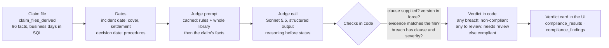
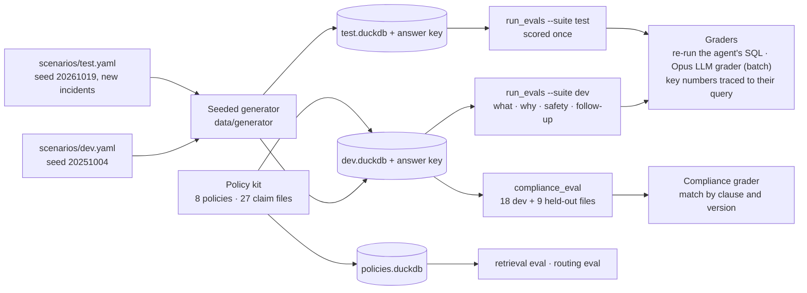

# Architecture diagrams

As of 2026-10-19. The same diagrams, with the tools, results and guardrails around them, are in [architecture_overview.html](architecture_overview.html) (open it in a browser). The design and its reasons are in [architecture.md](architecture.md).

## How a question flows

The app fixes the user's role and starts the MCP servers for it. The LangGraph loop calls Claude until it writes a structured report. Nothing the model calls can write to data; actions wait for a person. Every role except the fraud team lead is connected to the copy without personal data.

```mermaid
flowchart LR
  U["User<br/>Streamlit UI · CLI"] -->|"question + role"| G
  subgraph AG ["Agent · agent/graph.py"]
    direction TB
    G["LangGraph loop<br/>Claude Sonnet 5.5, medium effort"] --> R["Structured report<br/>answer · SQL · findings · hypotheses<br/>data issues · charts · proposed actions"]
  end
  G -->|MCP| W["Warehouse server<br/>one per role"]
  G -->|MCP| P["Policies server<br/>read-only"]
  G -->|"agent-side tool"| C["Compliance review<br/>check_claim_compliance"]
  W --> SG{{"SQL guard<br/>one SELECT · read-only"}}
  SG --> DW[("dev.duckdb<br/>full copy")]
  SG --> DR[("dev_restricted.duckdb<br/>no names or emails")]
  P --> KB[("policies.duckdb<br/>252 clauses · 8 policies")]
  C --> DR
  C --> KB
  C -->|"judge call"| J["Claude<br/>structured output"]
  R -->|"proposed tickets, alerts"| A{"Person approves?"}
  A -->|"approved only"| X["Actions server<br/>create_ticket · create_alert<br/>optionally a GitHub issue"]
  G -.-> L["Spend ledger · local traces · Langfuse"]
```

## A compliance review

The agent uses full context: the whole policy library fits in one cached prompt. Code, not the model, checks every finding and sets the verdict. The checklist design (v1) instead retrieves clauses per area and makes ten judge calls, with one retry when validation fails. Results: [compliance_results.md](compliance_results.md).

## Data and evaluation

The agent never sees an answer key. The test data was generated once, after all development, and each of its questions was asked once.

