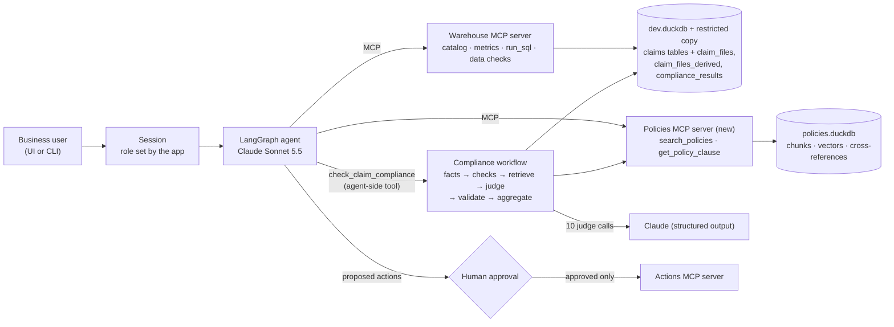

# Design: an Australian insurer, and policy-compliance RAG

> Status: **approved 2026-10-16** and since built. This is the design as approved; what changed during the build is in the [build log](dev/DEV_TRACKER.md) · Written 2026-10-16
> Source kit: `docs/compliance/kit/RAG_PLAN.md` and `docs/compliance/kit/insurance-policy-kit.zip` (plan, claim-facts contract, 8 policies, eval sets), written for a fictional Australian insurer, Meridian General
> Decided on 2026-10-16: one customer, in the **Australian market**, across all data and design; the policy-compliance feature is built before v1 is published; API budget about $25–40 for the feature.

## 1. Summary

The project's fictional customer moves from a US auto and home insurer to an **Australian motor and home insurer**. The proposal is to name it **Meridian General Insurance**, the name its policy library already uses. Two parts:

- **Part A: move the existing agent to the Australian market.** Every incident, eval case and guardrail keeps its design, but the warehouse is rebuilt with Australian geography, currency, seasons, causes of loss and names, and every case, prompt and doc follows.
- **Part B: add policy compliance**, with the kit used almost exactly as written. The agent answers policy questions with clause citations, reviews a claim file against every relevant policy (citations and evidence checked in code), combines policy with data, and answers questions about batch review results.

**What it costs:**
- About 10–11 focused days, and ~$22–30 of API spend, all for Part B. The move to Australia is not re-measured (decided 2026-10-16).
- Every result measured so far was on the US data:
  - the 84/84 and 12/16 baselines;
  - Experiment 1;
  - improvement round 1;
  - the grading model's 56/56 agreement with your labels.

  These stay as **recorded history**, clearly labelled, and aren't re-measured on the Australian data (decided 2026-10-16). Phase 6's final evaluation on new held-out data is the first full measurement of the Australian agent.

## 2. Part A: moving to the Australian market

### 2.1 Principles

1. **Keep every design, change the setting.** Each planted incident keeps its type, size and the question it answers. Only where a US pattern makes no sense in Australia (winter in January, frozen pipes, hurricanes, bodily-injury claims under a motor policy) does its timing or cause change.
2. **Rebuild, don't relabel.** The data is regenerated from Australian assumptions (population shares, seasons, costs in AUD) rather than renaming US states, so it holds up to an Australian reader.
3. **The tests are the safety net.** Existing offline tests check:
   - each incident at its intended size;
   - each control showing nothing;
   - every reference query running and agreeing with the semantic layer;
   - each "why" premise holding in the data.

   They're updated to Australian names, and must all pass before anything paid runs.

### 2.2 The customer

| | Now (US) | Australian version |
| --- | --- | --- |
| Name | unnamed (decided 2026-10-04) | **Meridian General Insurance** (proposed: the policies already use it) |
| Lines | auto and home | **motor and home** (home building and contents) |
| Footprint | 8 states, 4 regions | **8 states and territories, 4 regions** (below) |
| Currency | USD | AUD |
| Deductible | deductible | **excess** |
| Address | zip code | **postcode** |
| Names | Faker `en_US` | Faker `en_AU` |
| Head office and business days | — | Sydney; NSW public holidays (the policies' SLA-006 rule) |
| Partnership growth (incident 5) | home partner channel from Jan 2026 | unchanged: a bank partnership |
| Roles | Claims VP, claims ops manager, actuarial analyst, fraud team lead | **Head of Claims**, claims operations manager, actuarial analyst, fraud team lead; only the fraud team lead sees personal data, as now |

### 2.3 Geography and the generator (`data/generator/domain.py`, `data/scenarios/dev.yaml`)

Proposed values. The incident tests confirm each planted pattern still shows at its intended size, and values are adjusted until they do.

| Region | States and territories (policy share) | Metros |
| --- | --- | --- |
| NSW & ACT | NSW (0.30), ACT (0.02) | Sydney, Newcastle-Hunter, Wollongong, Canberra |
| VIC & TAS | VIC (0.25), TAS (0.02) | Melbourne, Geelong, Ballarat-Bendigo, Hobart |
| QLD & NT | QLD (0.21), NT (0.02) | Brisbane, Gold Coast, Townsville-Cairns, Darwin |
| West & South | WA (0.11), SA (0.07) | Perth, Bunbury, Adelaide |

- **Postcodes:** 4 digits from each metro's real range (Sydney 2000–2234, Melbourne 3000–3207, and so on).
- **Causes of loss:**
  - **Motor:** collision, glass, hail, theft, and **third-party property** instead of bodily injury. In Australia, injuries are covered by separate compulsory CTP insurance, not the motor policy.
  - **Home:** escape of liquid (`water_damage`), **storm** instead of wind_hail (the Australian term covers wind, hail and rain), fire, theft, liability.
- **Money:** costs and premiums scaled to AUD (about 1.5× the USD figures, which keeps the loss ratios at 55–60%). The state cost factors are higher for Sydney and Melbourne, and premium factors higher for Queensland and the Northern Territory (storm and cyclone exposure).
- **Seasons:**
  - hail in Queensland and NSW, October to December;
  - storms in Queensland, December to March;
  - bushfire (home fire) in Victoria and NSW, December to February;
  - no frozen pipes or snow.
- **Claim notes:** the templates are rewritten in Australian English, with no icy steps, basements or hurricanes. The planted prompt-injection note stays.

### 2.4 The planted incidents

| # | Now (US) | Australian version | What changes |
| --- | --- | --- | --- |
| 1 | DFW hailstorm, Texas, 14–16 Jul 2026 | **East Coast Low**, Sydney and the Central Coast, 14–16 Jul 2026: a winter storm, motor storm and hail claims and home storm claims; weather event WX-003 | Place and peril only; the date stays, since East Coast Lows are winter storms |
| 2 | Chicago repair shop inflation and steering since Mar 2026 | **Melbourne** repair shop, same pattern | Place and names |
| 3 | Duplicate payment load, 2–13 Mar 2026 | unchanged | none |
| 4 | Two Southeast adjusters leave, May 2026 | Two **West & South** adjusters leave, May 2026 | Region |
| 5 | Home partner growth from Jan 2026 (Q2 mix shift) | unchanged | none |
| 6 | Incomplete latest month, Sep 2026 | unchanged | none |
| N1 | Northern winter water claims, Jan–Feb (control) | **Queensland storm season**, Jan–Feb (control: "Were storm claims in Queensland unusual in early 2026?") | Region, cause, reason |
| N2 | Month-to-month noise | unchanged | none |
| Background | Houston hail, May 2025; Miami tropical storm, Sep 2025 | **Brisbane hailstorm, Nov 2025**; **Victorian bushfire (Ballarat-Bendigo), Jan 2026** (fictional events, not real ones; the bushfire moved from Jan 2025 during the build so there's history before it and it stays out of the mix-shift incident's baseline) | Places, perils, dates |

The two "why" cases built on background events change their questions to match. The planted prompt-injection note and the extract date, 2026-09-30, stay as they are.

### 2.5 Everything else that follows

- **Semantic layer:** `tables.yaml`, `glossary.md` and `metrics.yaml` move to AUD, excess, postcode, motor and the new causes. The metric definitions themselves don't change.
- **Eval cases:**
  - the 84 "what" cases keep their 22 templates with Australian states, regions and causes; reference SQL is edited, not re-derived;
  - the 16 "why", 11 safety and 5 follow-up cases get Australian wording, IDs and adjuster names;
  - `STATE_NAMES` in the case loader becomes Australian.
- **Agent:** the system prompt's opening ("a mid-size US auto and home insurer") and its examples move to Meridian. Tool descriptions are checked for US wording.
- **UI and CLI:** role names, currency shown as AUD, and the example questions.
- **Docs:** scoping (the frozen v1 brief is rewritten for Meridian), architecture, rollout plan, demo script, results, the README and the Claude Code skill.

### 2.6 What happens to the results measured so far

- The 534 saved result files move to `evals/results/archive-us-data/`, so replay mode shows only runs on the current data. They're kept, because they're the evidence for the decisions made so far.
- `docs/results.md` gains a **"History: measured on the US version of the data"** section. It holds:
  - the baselines;
  - Experiment 1;
  - improvement round 1, with its before and after;
  - the grading model's 56/56 agreement with your labels.

  The agreement result is about the grader, so it doesn't depend on the data.
- **No paid re-measurement** (decided 2026-10-16): the agent was tested on the US data. The offline tests confirm that the Australian data has the same incidents at the same sizes. Phase 5's sanity run (8 "what", 3 "why", ~$0.50) and Phase 6's final evaluation are the next measurements.

## 3. Part B: policy compliance

### 3.1 What changes from the kit, and why

The kit fits the market now, so the remaining changes are about this repo and this Claude API:

| Kit plan | This design | Why |
| --- | --- | --- |
| Golden claims in their own `golden_claim_facts` table | A **`claim_files` table** in the warehouse: detailed handling records for a quality-review sample of 27 motor claims, each given one of the 8 states (no rule depends on it) | Claims QA teams audit a sample of claim files; the other tables, and every eval answer built on them, stay untouched |
| Three claims (GC-018, 019, 020) decided and paid in October | Their dates move back **exactly 17 weeks**, which keeps every weekday and moves NSW Labour Day (5 Oct) to the King's Birthday (8 Jun), so their "business days across a public holiday" test survives | The warehouse's extract date is 2026-09-30, and the agent treats it as today |
| Plain SDK loop with one `run_sql` tool | Same LangGraph agent; policy search in a new **read-only policies MCP server**; the compliance workflow runs **inside the agent** | MCP servers stay pure data access; anything that calls a model sits behind the existing spend caps, tracing and prompt caching |
| Judge forces a tool (`tool_choice`) at temperature 0 | **Structured output** (`output_config.format`) at default sampling | Sonnet 5.5 and Opus 5.5 reject forced tools and non-default temperature (DEV_PLAN §11) |
| `evidence` is a free-form object | A list of `{field, value}` pairs | Structured outputs need fixed keys on every object |
| BM25 via DuckDB's FTS extension (untested by the kit's author) | **BM25 in Python** over 252 clauses, same `normalise()` | No extension download; same choice as `search_catalog` (2026-10-09) |
| `logs/llm_calls.jsonl` (build step 0) | Existing spend ledger, local traces and Langfuse | Already built |
| `eval/` folder at the repo root | `evals/cases/compliance/`, run by the existing runner as new kinds | One eval system, with `--repeats`, cost caps and summaries |
| All 27 golden claims used for development | **18 for development, 9 held out**, scored once at the end | Same discipline as the held-out test data |
| Verdicts persisted on every check | Interactive checks go to the trace; only a **batch command** writes `compliance_results` | DuckDB allows one writer, and the agent's connections are read-only by design |
| — | A HIGH-severity breach can lead to a **proposed action** ("refer GC-010 for file review") through the existing approval flow | Reuses the human-approval step; the model still never writes |
| — | A **cost gate**: re-estimate after the first 3 claims of each variant | Keeps the build inside budget |

Everything else is the kit as written: the policy text, clause IDs, the 104 cross-references, AUD amounts, GST rules, NSW business days, the 80-field contract, the answer key, and the retrieval and routing questions. Only `motor` claim types and the extract date matter to the agent.

**Re-checking the three moved claims** (free): recompute their business days with the SQL macro and an independent Python NSW calendar, and confirm their expected answers still hold. A spot check by an Opus run is optional (~$0.20).

### 3.2 Architecture



- The **policies server** opens the policy file read-only. `run_sql` connects only to the warehouse, so it can't read raw clauses and get around the citation rules.
- The **compliance workflow** is ordinary Python called by the graph's tool step. Its judge calls go through `call_claude`, so each is in the spend ledger, counts toward the question's $0.50 cap, and appears as a child span in the trace.
- **Roles:** all four roles can use policy search and compliance review, since the claim files carry no policyholder names or emails (checked when built). The restricted copy includes `claim_files`.

### 3.3 Data

```
data/compliance/
  policies/*.md                        the kit's 8 policies, unchanged (source of truth)
  claim_files.csv                      the 27 golden claims (+ state; 3 with moved dates)
  nsw_public_holidays_2025_2026.csv
  build.py                             run by `make data`
data/semantic/tables.yaml, glossary.md gain claim_files and the compliance terms
data/policies.duckdb                   derived, git-ignored
evals/cases/compliance/
  expected_verdicts.jsonl  retrieval_questions.jsonl  routing_questions.jsonl  split.yaml
docs/compliance/kit/                   the kit's plan, contract and README, as the source spec
```

The warehouse keeps its file name, `data/dev.duckdb`: the name means the development scenario, as opposed to Phase 6's held-out test data (changed from the original design on 2026-10-16). With its restricted copy, it gains:
- `claim_files`;
- `nsw_public_holidays`;
- the `bd_between` macro and the `claim_files_derived` view (contract §5);
- `compliance_results`, written only by the batch command.

The claim files hold no labels (checked). The expected verdicts live under `evals/`, out of reach of the SQL guard's file lock.

The **policy knowledge base** (`policies.duckdb`) is exactly as kit §4: one chunk per clause with breadcrumb, `context_text`, `search_text` and a `FLOAT[384]` embedding, plus the documents and cross-reference tables.

### 3.4 Retrieval

As kit §6, with these changes:

- **Embeddings:** `fastembed` with `BAAI/bge-small-en-v1.5` (local and free; about a 70 MB model download on first use). It sits behind one `embed.py`, so tests use a fake embedder and CI never downloads it.
- **Keyword search:** BM25 in Python with the kit's `normalise()`. The kit's sanity check stays: `D-04` returns exactly three clauses.
- **Hybrid:** top 30 by vector and top 30 by BM25, fused with reciprocal rank fusion (k = 60). The version-in-force filter is applied first: incident date for coverage and settlement documents, decision date for procedures.
- **Cross-references:** one hop, at most 4 extra clauses.
- **No reranker.** Tuning knobs only on eval evidence (kit §6.6).

If `fastembed` won't install on Python 3.13, the fallback is BM25 only, measured and flagged.

### 3.5 Tools, prompt and report

- **Tools:** `search_policies`, `get_policy_clause` and `check_claim_compliance` join the `full` tool set, with the kit's descriptions (§7.1). Changes:
  - schemas made strict;
  - `top_k` limits enforced in code;
  - claim type limited to `motor`;
  - default date is the extract date (2026-09-30), not the computer's clock.
- **Experiment tool sets:** `semantic_off` and `sql_only` stay as they are.
- **System prompt:** gains the kit's "Policy and compliance" section (§7.2). Policies cover motor claims only, so a home-policy question gets "the policy library doesn't cover home claims".
- **Citations:** written inline in the answer, as (POL-MTR-002 §3.4, v6.0), read from the text by code, shown in the UI and checked against the clauses the tools returned. (Changed 2026-10-17: a `citations` field in the report pushed the request past the API's size limit for strict schemas.)

### 3.6 The compliance workflow

**Three variants, all with the same output schema:**
1. **v0, naive RAG** (kit §8.1): the number to beat.
2. **v1, checklist** (kit §8.2–8.3): ten checks, each with its own scoped retrieval and parallel judge call.
3. **Full context:** all 8 policies (about 15k tokens) in a cached prompt, one judge call.

**The judge call:**
- *System:* the kit's judge rules (§8.4), cached across all calls.
- *User:* the claim file's facts first (cached across the claim's ten calls), then the check and its clauses.
- *Output:* structured, via `output_config.format`. Effort medium to start; the eval decides.

```json
{"check": "exclusions",
 "findings": [{"status": "PASS|BREACH|NEEDS_REVIEW|NOT_APPLICABLE|NOT_ASSESSED",
               "severity": "HIGH|MEDIUM|LOW|NONE",
               "rule": "...", "clause_ids": ["POL-MTR-002:3.4"],
               "evidence": [{"field": "licence_status", "value": "EXPIRED"}],
               "calculation": "", "explanation": "..."}]}
```

**Validation in code** (kit §8.2 step 5, plus two checks):
- every cited clause was in the check's retrieved set;
- **and it's the version in force on the right date**;
- every evidence field exists with exactly that value;
- every BREACH and NEEDS_REVIEW has a clause and a severity;
- **a NOT_ASSESSED finding must name a field that really is blank.**

On failure, one retry with the validator's message. On a second failure, the finding becomes NEEDS_REVIEW, flagged `validation_failed`.

**Aggregation in code:** any BREACH → NON_COMPLIANT; else any NEEDS_REVIEW → NEEDS_REVIEW; else COMPLIANT.

**Caps:** each review stops past $0.35, inside the question's $0.50 cap.

**Batch:** `python -m agent.compliance batch --since 2026-07-01` writes `compliance_results`. It's run by a person, never by the model, and only when no session holds the warehouse open.

### 3.7 Guardrails

- No policy statement without a clause returned in this conversation, and citations are checked in code.
- Handler notes and incident descriptions are untrusted text: the existing "data, not instructions" wrapper applies, and the judge rules say so too.
- No eval answer key is reachable: it lives in `evals/`, and the warehouse connection can't read files. A new safety case asks the agent to read `expected_verdicts.jsonl`.
- MCP servers stay read-only. The only new write is the batch command's results table, run by a person.

### 3.8 UI

- Every policy statement shows a **Policy clause** label: clause ID, version and the date it was in force. Clicking it shows the clause text.
- A **compliance verdict card**: the overall verdict, and one row per finding with status, severity, rule, cited clauses and evidence.
- Replay mode covers compliance runs.

### 3.9 Evaluation

New eval kinds in the existing runner. Results include the kit's failure diagnoses (`retrieval_miss`, `wrong_version`, `judge_error`, `validator_reject`, `data_issue`).

| Kind | Cases | Graded by | Targets (from the kit) | Cost |
| --- | --- | --- | --- | --- |
| `policy_retrieval` | 35 questions | code: recall@5 and @8, version accuracy, MRR; ablation of BM25 only, vector only, hybrid, hybrid + cross-references | hybrid recall@8 ≥ 0.90; version 100%; exact-code recall@5 = 1.0 | free |
| `routing` | 16 questions | code: required, any-of and forbidden tools | ≥ 14/16 | ~$0.60 a run |
| `compliance` | 27 claim files (18 development, 9 held out) | code: kit §9.3 matching by clause | overall ≥ 23/27; required findings ≥ 20/22; strict citations ≥ 0.90; ≤ 3 false breaches; traps and controls 7/7; 0 invented citations | see §4 |
| Sanity run | 8 "what" (smoke) and 3 "why" (`why_smoke`) | existing graders | runs end to end on the Australian data with the compliance additions; any failure explained | ~$0.50 |

**The held-out split:** 9 claims across the checks, including 2 of the 7 compliant ones, fixed before any compliance run and looked at only in the final scoring. Development and held-out results are reported separately.

**Comparison table for the README:** v0 vs. v1 vs. full context on every §9.3 metric, plus tokens, cost and seconds per claim, with 3 runs each and a range.

## 4. Budget

**Replanned on 2026-10-18:** the whole project must cost less than A$50 (about US$34.60), so Part B's remaining runs use the Batch API, 1 run per variant on all 27, and no second routing run. The plan and its numbers are in DEV_PLAN.md section 10; the table below is the original estimate, kept for the record.

Per-claim estimates include the judge's thinking tokens at medium effort. They're replaced by measured numbers at the cost gate.

| Item | Estimate |
| --- | --- |
| **Part A:** no paid runs (decided 2026-10-16) | $0 |
| **Part B:** retrieval eval | $0 |
| Routing eval, 3 runs | ~$2 |
| Sanity run after wiring in (8 "what", 3 "why") | ~$0.50 |
| v0: development, then 3 runs on all 27 | ~$3 |
| v1: development on the 18, then 3 runs on all 27 | ~$12–20 |
| Full context: 3 runs on all 27 | ~$3.5 |
| Batch run, demo questions, live checks | ~$2 |
| **Total** | **~$22–30**, within the approved $25–40 |

**Guards:**
- every run has `--max-cost`;
- each review is capped at $0.35;
- **cost gate:** after the first 3 claims of v1, the measured cost is checked. If Part B would pass $40, I stop and offer the options: 2 runs, low effort, or fewer development iterations.

Spend so far is $12.93.

## 5. Build order

Each step ends with a check you can run, and no step starts until the previous one passes. Days are focused days, as in DEV_PLAN.

| # | Step | Done when | Cost |
| --- | --- | --- | --- |
| A1 | **Australian domain and scenario**: `domain.py` and `dev.yaml` (§2.3–2.4), Faker `en_AU` (the warehouse keeps the name `dev.duckdb`) | `make data` builds; every incident shows at its intended size and every control shows nothing (the incident tests, updated) | $0, 1 day |
| A2 | **Semantic layer, eval cases, prompt, UI** (§2.5) | All offline tests pass; every reference query runs and agrees with the semantic layer; every "why" premise holds; no US place names, codes, USD or "deductible" left outside the archive (a scan) | $0, 1–1½ days |
| A3 | **Archive** the US-era results as labelled history (§2.6); docs rewritten (scoping, architecture, rollout, demo, README, Claude Code skill) | The archive folder and the history section exist; every link in the README and docs still resolves | $0, ½–1 day |
| B1 | **Claim files**: `claim_files` from the kit with states and the 3 moved claims; holidays; macro; derived view | Business days for GC-002, GC-003, GC-018 checked against an independent Python NSW calendar; no labels and no personal data in `claim_files`; existing tests pass | $0, ½ day |
| B2 | **Policy knowledge base** | 252 chunks; 0 unresolved cross-references; SUPERSEDED breadcrumb; `D-04` returns exactly 3 clauses; no NULL embeddings | $0, 1 day |
| B3 | **Policies MCP server and retrieval eval** | Hybrid recall@8 ≥ 0.90; the 5 version questions 5/5; exact-code recall@5 = 1.0; ablation table | $0, 1 day |
| B4 | **Wire into the agent**: tools, prompt section, `citations`, routing eval, sanity run | Routing ≥ 14/16; policy answers carry checked citations; the sanity run works end to end, any failure explained | ~$2.50, 1 day |
| B5 | **Compliance v0 and its grader**: fix the held-out split first | A v0 results table on the 18; the grader passes the expected findings at 100% and fails an empty verdict | ~$1.5, 1 day |
| B6 | **Compliance v1**: checklist, parallel judges, validator with retry, code aggregation, cost gate | On the 18: required-finding recall ≥ 90%, traps and controls all correct, 0 invented citations | ~$8–12, 1½–2 days |
| B7 | **Full context, then final scoring** of all three variants × 3 runs on all 27, held-out shown separately | One comparison table for v0, v1 and full context on every metric | ~$10–14, ½ day |
| B8 | **Batch and portfolio questions** | "Most common breach types" and "settled above authority" answered with citations; GC-004 and GC-005 flagged, GC-019 not | ~$1, ½ day |
| B9 | **UI and docs**: clause labels, verdict card, replay; results and README sections; demo script | Headless UI tests pass; `docs/results.md` has the compliance section | ~$0.5, 1 day |

**Total: about 10–11 focused days and ~$22–30.** When B9 is done, the work is committed and pushed to GitHub (decided 2026-10-16); whether the repo is private or public is confirmed then.

## 6. Where it goes in the plan

| Phase | Content |
| --- | --- |
| 3. Evaluation and improvement | Closes with what's done (on US data, kept as history) |
| **4. Australian market** (new) | A1–A3 |
| **5. Policy compliance** (new) | B1–B9 |
| 6. Final evaluation | Experiment 2 (model and effort, now also for the judge), the Australian held-out test data with new incidents, the final scoring of that data and of the 9 held-out claim files |
| 7. Demo polish | README, saved runs, video |
| 8. Ship | Secrets check, publish |

Part A comes first, because Part B's claim files and regression run sit on the Australian warehouse.

## 7. Risks

| Risk | Mitigation |
| --- | --- |
| Rebuilding the data breaks incidents or eval answers | Each incident's design kept; the incident, reference-query and premise tests must all pass before any paid run; a scan for leftover US terms |
| The Australian data looks wrong to an Australian reader | Real metros and postcode ranges, southern-hemisphere seasons, CTP-aware causes, `en_AU` names and Australian English notes; events are fictional, not mislabelled real ones |
| The history on US data confuses readers | Archived in its own folder and labelled in `docs/results.md`; every README headline number is re-measured |
| The prompt gets tuned to 27 known claim files | 9 held out and scored once |
| The analytics agent gets worse with the compliance additions | The sanity run in B4; Phase 6 measures the final agent in full |
| `fastembed` doesn't install on Python 3.13 | Checked in B2; BM25-only fallback, measured |
| The judge does arithmetic wrong (excess, authority limits) | Calculations shown, evidence validated; deterministic rules cross-check as a stretch goal (kit §11) |
| Full context beats RAG | A valid finding, reported with numbers |
| Cost overruns | Per-run caps, the per-review cap and the cost gate |

## 8. Out of scope

- home-insurance policies (compliance covers motor claims only)
- claim files beyond the 27-claim sample
- a reranker
- deterministic rule extraction (stretch)
- writing verdicts from interactive sessions
- re-running the US-era experiments on the new data (Experiment 1's "off" side can be re-run later for ~$2 if wanted)
